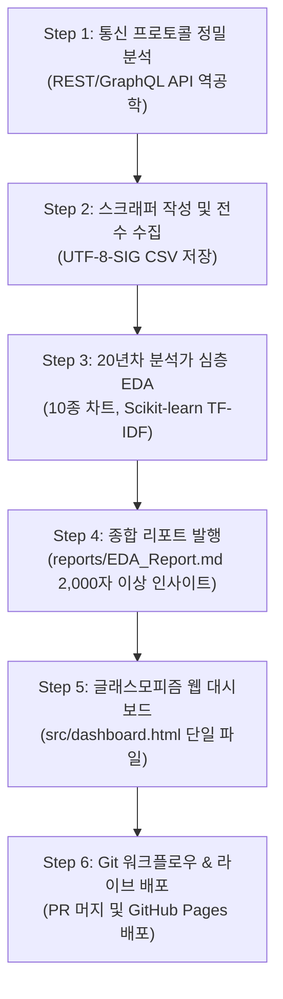

# 🚀 Universal Data Pipeline (범용 데이터 수집·분석·대시보드 파이프라인)

본 스킬은 어떠한 신규 사이트라도 데이터 수집부터 최종 인터랙티브 웹 대시보드 라이브 배포까지 정형화된 표준 절차를 통해 성공적으로 수행할 수 있도록 엔지니어링 지침과 템플릿을 제공합니다.

---

## 📋 핵심 6단계 엔드투엔드 워크플로우

---

### Step 1: 사이트 구조 및 통신 프로토콜 정밀 분석
1. **타깃 사이트 URL 식별**: 수집하고자 하는 대상 페이지(예: 베스트셀러, 실시간 랭킹, 상품 목록 등) 확인
2. **REST / GraphQL Gateway API 역공학 (최우선)**:
   - 브라우저 개발자 도구(F12)의 `Network` -> `Fetch/XHR` 탭 필터링
   - 목록 갱신 또는 페이지 번호 클릭 시 전송되는 요청 URL, HTTP Method, Query Parameter, Request Header(특히 User-Agent, Referer, Authorization) 식별
   - JSON 응답 구조(필드명, 중첩 데이터 계층, 총 데이터 건수 필드) 파악
3. **폴백(Fallback) 전략**:
   - 내부 API가 미노출된 정적 페이지: `urllib.request` / `requests` + `BeautifulSoup` 정적 스크래핑
   - 복잡한 자바스크립트 CSR 및 봇 차단 페이지: `Playwright` 헤드리스 브라우저 구동

---

### Step 2: 스크래퍼 구축 및 전수 수집
1. **표준 디렉터리 구성**:
   - 프로젝트 루트 아래 `{site_name}/` 폴더 생성 및 5대 표준 서브폴더(`data/`, `src/`, `images/`, `docs/`, `reports/`) 구축
2. **스크래퍼 스크립트 작성 (`src/scraper.py`)**:
   - `templates/scraper_template.py`를 기반으로 작성
   - GZIP 응답(`0x1f 0x8b`) 자동 압축 해제 처리
   - 요청 간 대기시간(`time.sleep(0.5)`) 의무 적용으로 서버 부하 방지
   - HTML 엔티티 정제(`&lt;`, `&gt;`, `&amp;` 및 태그 제거)
3. **데이터 저장 및 무결성 검증**:
   - 엑셀 호환을 위해 반드시 **`UTF-8-SIG`** 인코딩으로 CSV 저장
   - 파일명: `data/{site}_daily_{category}_{YYYYMMDD}.csv`
   - `.agents/hooks/verify_csv_integrity.py`를 실행하여 100% 무결성(행 수, 결측치 0%, 순위 연속성) 확인

---

### Step 3: 심층 탐색적 데이터 분석 (EDA)
1. **20년차 데이터 분석가 가이드라인 준수**:
   - `templates/eda_template.py` 템플릿 기반 구현
   - 데이터 기본 정보: `head()`, `tail()`, `info()`, `describe()`, 결측치 및 중복치 점검
2. **시각화 공통 원칙**:
   - `import koreanize_matplotlib` 필수로 한글 깨짐 원천 차단
   - 전역 스타일(`sns.set_theme()`, `sns.set_style()`) 설정 금지 (단일 플롯 단위 스타일링)
   - 최소 10종 이상의 고해상도(DPI 150) 차트 생성 후 `images/` 폴더에 저장
3. **Scikit-learn 기반 텍스트 마이닝**:
   - 무거운 형태소 분석기 대신 `TfidfVectorizer`를 사용하여 주요 키워드 상위 30위 가중치 도출 및 시각화

---

### Step 4: 종합 분석 보고서 발행
1. **리포트 템플릿 활용**:
   - `templates/report_template.md`를 채워 `reports/EDA_Report.md` 파일로 작성
2. **심층 비즈니스 인사이트 작성 (필수)**:
   - 각 기술통계와 차트마다 단순 수치 해설이 아닌, 시장 구조, 소비자 반응, 가격 전략 등을 다각도로 해석하는 **최소 2,000자 이상의 비즈니스 제언** 서술

---

### Step 5: 글래스모피즘 인터랙티브 웹 대시보드 구축
1. **단일 파일(Single File HTML) 아키텍처**:
   - 별도 WAS 없이 로컬(`file://`) 및 정적 웹 호스팅에서 즉시 구동 가능하도록 데이터셋을 JSON 인라인 임베드
   - `templates/dashboard_template.html` 기반 커스터마이징
2. **UI & UX 시스템**:
   - 앰비언트 글로우(Ambient Glow) 배경 애니메이션 및 반투명 블러 패널
   - Chart.js v4 기반 6대 핵심 차트 탑재
   - 실시간 검색, 다중 드롭다운 필터, 정렬 가능한 테이블, 모달 상세 팝업, 필터링 결과 CSV 내보내기

---

### Step 6: Git 워크플로우 및 라이브 배포
1. **Git 버전 관리**:
   - `feat/{site}-pipeline` 브랜치 생성 및 Conventional Commit 적용
2. **온라인 라이브 배포 (GitHub Pages)**:
   - `gh-pages` 브랜치에 배포용 `index.html`로 대시보드 복사 후 푸시
   - 웹앱 URL(`https://{username}.github.io/{repo}/`) 접속 확인 및 루트 `README.md` 링크 갱신

---

## 📂 제공 템플릿 자산 안내

모든 템플릿은 본 스킬 디렉터리의 `templates/` 폴더에 위치합니다:
- `templates/scraper_template.py`: 재시도, 세션 관리, 페이징 처리가 내장된 API 수집기 템플릿
- `templates/eda_template.py`: 10종 차트 및 TF-IDF 키워드 분석 자동화 스크립트
- `templates/dashboard_template.html`: 화이트/다크 글래스모피즘 반응형 대시보드 템플릿
- `templates/report_template.md`: 20년차 데이터 분석가 표준 마크다운 보고서 서식
