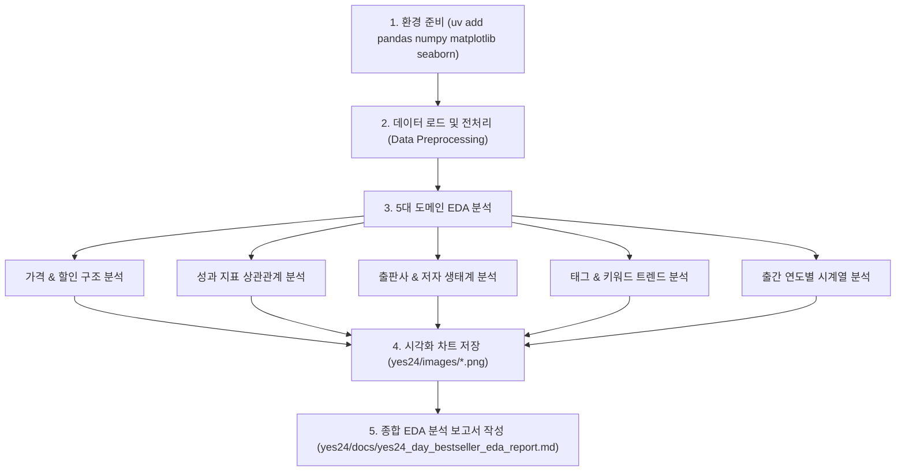

# YES24 일별 베스트셀러 데이터셋 EDA(탐색적 데이터 분석) 계획

## 1. Goal Description
[`yes24/data/yes24_day_bestseller.csv`](file:///C:/FTC_downloads/Antigravity_project/myfirst_project/DATACRAWLING/yes24/data/yes24_day_bestseller.csv)에 수집된 YES24 IT/모바일 분야 일별 베스트셀러 285건의 데이터를 대상으로, 비즈니스 및 시장 인사이트를 도출하기 위한 종합적인 **EDA(Exploratory Data Analysis)**를 수행합니다.

본 계획은 다음과 같은 핵심 질문에 답하는 것을 목표로 합니다:
1. **도서 시장 가격 구조**: IT/모바일 분야 도서의 평균 가격대와 할인 정책은 어떻게 형성되어 있는가?
2. **인기 지표 간의 상관성**: 순위(rank), 판매지수(sales_index), 리뷰 수(review_count), 평점(rating) 사이에는 어떤 통계적 상관관계가 존재하는가?
3. **출판사 시장 점유율**: 베스트셀러 순위를 주도하는 주요 출판사는 어디이며 집중도는 어떠한가?
4. **IT 기술 키워드 트렌드**: 현재 베스트셀러에서 가장 주목받는 기술 주제(AI, 파이썬, 자격증, 클라우드 등)는 무엇인가?
5. **신간 vs 스테디셀러 비중**: 베스트셀러 내에서 최신 출간 도서와 롱테일 스테디셀러의 비중은 어떻게 분포하는가?

---

## 2. User Review Required

> [!IMPORTANT]
> **1. 라이브러리 설치 필요성**:
> 분석 및 시각화를 위해 `uv add pandas numpy matplotlib seaborn` 명령을 통해 데이터 분석 패키지 설치가 필요합니다. 기존 워크스페이스 공통 가상환경(`.venv`)에 설치됩니다.
>
> **2. 시각화 및 문서 산출물 형식**:
> - 시각화 차트: [`yes24/images/`](file:///C:/FTC_downloads/Antigravity_project/myfirst_project/DATACRAWLING/yes24/images) 폴더에 고해상도 PNG 이미지(한글 폰트 '맑은 고딕' 적용) 저장
> - 분석 코드: [`yes24/src/yes24_eda_analysis.py`](file:///C:/FTC_downloads/Antigravity_project/myfirst_project/DATACRAWLING/yes24/src/yes24_eda_analysis.py) (규칙에 따른 최상단 모듈 docstring 작성)
> - 최종 보고서: [`yes24/docs/yes24_day_bestseller_eda_report.md`](file:///C:/FTC_downloads/Antigravity_project/myfirst_project/DATACRAWLING/yes24/docs/yes24_day_bestseller_eda_report.md)에 상세 인사이트 정리

---

## 3. Open Questions

> [!NOTE]
> - **주피터 노트북(.ipynb) 생성 여부**: 기본적으로 재현 가능한 파이썬 스크립트(`.py`)와 마크다운 보고서(`.md`)를 생성하도록 설계되어 있습니다. 인터랙티브한 셀 단위 탐색을 원하실 경우 주피터 노트북 파일([`yes24/src/yes24_bestseller_eda.ipynb`](file:///C:/FTC_downloads/Antigravity_project/myfirst_project/DATACRAWLING/yes24/src/yes24_bestseller_eda.ipynb))도 함께 작성할 수 있습니다.

---

## 4. Proposed Changes



### [Phase 1: 의존성 설치 및 환경 설정]
- `uv add pandas numpy matplotlib seaborn` 실행
- Windows 환경에 최적화된 한글 폰트(`Malgun Gothic`) 및 음수 부호 깨짐 방지(`axes.unicode_minus = False`) 설정

---

### [Phase 2: EDA 분석 스크립트 구현]

#### [NEW] [`yes24/src/yes24_eda_analysis.py`](file:///C:/FTC_downloads/Antigravity_project/myfirst_project/DATACRAWLING/yes24/src/yes24_eda_analysis.py)
* **모듈 Docstring**: 파일 맨 첫 줄부터 한국어 모듈 Docstring 작성 (사용자 규칙 준수)
* **데이터 정제 & 파생 변수 생성**:
  - 수치형 컬럼 정수/부동소수점 변환 (`fixed_price`, `sale_price`, `discount_rate`, `point`, `rating`, `review_count`, `sales_index`)
  - 결측치 및 0값 처리 (평점 0.0은 미평가 도서로 분리)
  - `pub_date`에서 '출간연도'(`pub_year`)와 '출간월'(`pub_month`) 파생 변수 추출
  - 실질 할인액(`discount_amount = fixed_price - sale_price`) 계산
* **5가지 핵심 분석 및 시각화 저장**:
  1. **가격 및 할인율 분포**:
     - 정가/판매가 히스토그램 및 박스플롯 (`yes24/images/eda_01_price_distribution.png`)
     - 할인율별 도서 비중 파이차트 / 막대차트
  2. **순위 및 인기 지표 상관관계**:
     - 순위, 판매지수, 평점, 리뷰 수 피어슨/스피어만 상관계수 히트맵 (`yes24/images/eda_02_correlation_heatmap.png`)
     - 판매지수 vs 리뷰 수 산점도 및 추세선 (`yes24/images/eda_03_sales_vs_reviews.png`)
  3. **출판사 시장 점유율 분석**:
     - 상위 10대 출판사 도서 점유율 및 판매지수 합계 (`yes24/images/eda_04_top_publishers.png`)
     - 출판사별 평균 도서 가격 비교
  4. **기술 키워드 및 태그 워드 빈도 분석**:
     - `#` 태그 및 도서명 형태소/단어 빈도 분석 상위 20개 (`yes24/images/eda_05_keyword_frequency.png`)
     - 최신 AI/생성형 AI 관련 도서 비중 분석
  5. **출간 시기별 분포 (신간 vs 스테디셀러)**:
     - 연도별 출간 도서 수 및 판매지수 기여도 (`yes24/images/eda_06_pub_year_trend.png`)

---

### [Phase 3: 종합 EDA 분석 보고서 작성]

#### [NEW] [`yes24/docs/yes24_day_bestseller_eda_report.md`](file:///C:/FTC_downloads/Antigravity_project/myfirst_project/DATACRAWLING/yes24/docs/yes24_day_bestseller_eda_report.md)
* **데이터셋 요약 통계 테이블**: 총 도서 수, 결측치 현황, 평균/중앙값/표준편차
* **시각화 차트 이미지 임베딩**: `../images/*.png` 연계
* **주요 발견점(Key Findings)**:
  - 가격 정책의 정형성 (예: 10% 도서정가제 할인 패턴)
  - 베스트셀러를 견인하는 메이저 출판사 과점 현황
  - 2026년 현재 IT 베스트셀러를 주도하는 기술 테마(생성형 AI, LLM, 자동화 vs 기존 스테디셀러 프로그래밍 언어)
  - 신간 도서의 시장 진입 양상
* **후속 모델링/비즈니스 제언**: 추천 시스템 또는 베스트셀러 예측 모델 구축 시 활용 가능한 인사이트 제시

---

## 5. Verification Plan

### Automated Execution
```bash
# 1. 패키지 설치 확인
uv run python -c "import pandas, matplotlib, seaborn; print('Packages loaded successfully')"

# 2. EDA 분석 스크립트 실행 및 차트 생성 검증
uv run python yes24/src/yes24_eda_analysis.py

# 3. 이미지 생성 및 무결성 확인
Get-ChildItem yes24/images/ -Filter "eda_*.png"
```

### Manual Verification
1. [`yes24/images/`](file:///C:/FTC_downloads/Antigravity_project/myfirst_project/DATACRAWLING/yes24/images)에 생성된 6종류의 차트 파일에서 한글 폰트가 깨지지 않고 깔끔하게 렌더링되었는지 확인.
2. [`yes24/docs/yes24_day_bestseller_eda_report.md`](file:///C:/FTC_downloads/Antigravity_project/myfirst_project/DATACRAWLING/yes24/docs/yes24_day_bestseller_eda_report.md) 마크다운 보고서에 통계 표와 차트가 올바르게 배치되어 비즈니스 스토리가 충실히 전개되는지 검토.
