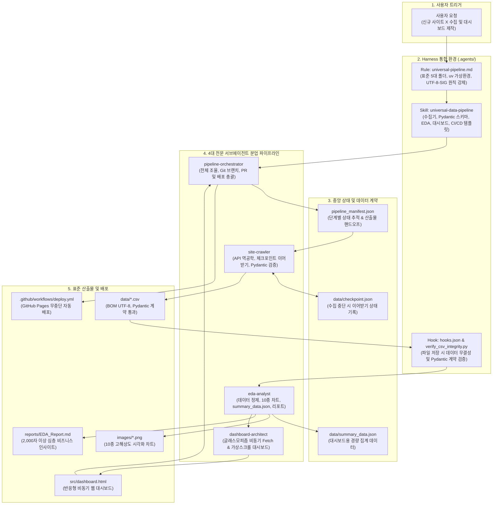
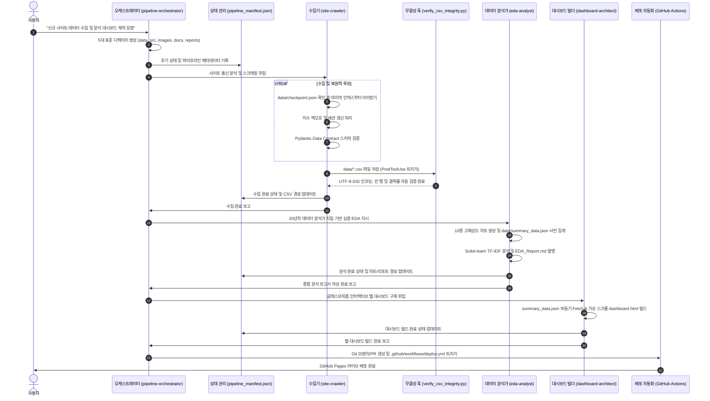

# [Harness] 범용 웹 수집·EDA·대시보드 자동화 프레임워크 아키텍처 (Hardened v2.0)

본 문서는 신규 웹사이트(이커머스, 포털, 채용, 커뮤니티 등)를 대상으로 데이터 수집부터 20년차 분석가 수준의 심층 EDA, 마크다운 종합 리포트, 글래스모피즘 인터랙티브 웹 대시보드 빌드 및 CI/CD 라이브 배포까지 전 과정을 표준화하여 완수하는 **Harness (범용 자동화 프레임워크)**의 고도화된 아키텍처와 실행 흐름을 정의합니다.

---

## 1. Harness 전체 아키텍처 및 파이프라인 흐름

Harness는 사용자의 신규 프로젝트 요청 시 **5대 핵심 자산(Rule, Skill, Hook, Subagents, Plan)과 5대 보완 체계(체크포인트, 데이터 계약, 매니페스트, 비동기 요약 데이터, CI/CD)**가 유기적으로 연계되어 결함 없는 엔드투엔드 파이프라인을 완수합니다.

---

## 2. 단계별 실행 시퀀스 (Lifecycle)

작업이 시작되면 중앙 상태 파일(`pipeline_manifest.json`)을 기반으로 각 에이전트와 도구가 순차적으로 상호작용하며 자동 검증과 복원력을 제공합니다.

---

## 3. Harness 핵심 컴포넌트 명세

| 컴포넌트 | 경로 / 식별자 | 주요 역할 및 특징 |
|---|---|---|
| **Rule** | `.agents/rules/universal-pipeline.md` | 표준 5대 폴더, `uv`(`.venv`), UTF-8-SIG, Pydantic 데이터 계약 준수 등 필수 규칙 강제 |
| **Skill** | `.agents/skills/universal-data-pipeline/SKILL.md` | 수집 템플릿, Pydantic 스키마 정의, 10종 시각화, `summary_data.json` 집계, 글래스모피즘 대시보드, CI 워크플로우 제공 |
| **Hook** | `.agents/hooks/verify_csv_integrity.py` | CSV 저장 시 BOM UTF-8, 빈 행, 결측률 검증 및 Pydantic 기반 스키마 이상치 차단 |
| **Subagents** | `site-crawler`, `eda-analyst`, `dashboard-architect`, `pipeline-orchestrator` | 컨텍스트 오염을 방지하고 각 영역별(수집/EDA/프론트엔드/배포) 독립 및 병렬 작업 수행 |
| **State Tracker** | `pipeline_manifest.json` | 에이전트 간 산출물 경로, 단계별 진행 상태(PENDING/IN_PROGRESS/COMPLETED), 오류 발생 시 롤백 정보 중앙 관리 |
| **Resilience State** | `data/checkpoint.json` | 네트워크 단절 및 레이트 리밋 발생 시 수집 재개를 위한 페이지/인덱스 체크포인트 |
| **Pre-aggregated Data**| `data/summary_data.json` | 대용량 데이터 시각화 렉을 방지하기 위한 대시보드 전용 경량 사전 집계 데이터 |
| **CI/CD Workflow** | `.github/workflows/deploy.yml` | PR 머지 기반 GitHub Pages 무중단 자동 배포 파이프라인 |

---

## 4. 6대 표준 실행 단계 상세

1. **Step 1: 사이트 구조 및 통신 프로토콜 정밀 분석**
   - 개발자 도구 네트워크 탭 분석 및 REST/GraphQL API 역공학 우선 탐색
   - User-Agent, 동적 세션 토큰 및 쿠키 자동 갱신 전략 수립
2. **Step 2: 복원력 높은 스크래퍼 구동 및 Pydantic 데이터 계약 검증**
   - `data/checkpoint.json` 상태 기반 수집 이어받기 지원
   - 지수 백오프(Exponential Backoff with Jitter) 및 429/403 방어
   - Pydantic 모델을 통한 타입, 필수값, 범위 유효성 검사 후 `data/*.csv` UTF-8-SIG 저장
3. **Step 3: 20년차 데이터 분석가 지침 기반 심층 EDA & 사전 집계**
   - 10종 이상 고해상도(300 DPI) 시각화 차트 생성 (`images/`)
   - Scikit-learn TF-IDF 키워드/바이그램 마이닝 및 통계적 이상치 검정
   - 대시보드 성능 보장을 위한 `data/summary_data.json` 경량 집계 데이터 사전 생성
4. **Step 4: 고품질 마크다운 종합 리포트 발행**
   - `reports/EDA_Report.md`에 2,000자 이상의 심층 비즈니스 인사이트 및 실행 전략 기술
5. **Step 5: 글래스모피즘 Chart.js 비동기 웹 대시보드 빌드**
   - `src/dashboard.html`에서 `summary_data.json`을 비동기 `fetch()`로 로딩
   - 상세 원천 데이터 테이블은 가상 스크롤(Virtualization) 또는 페이징 처리로 대용량 데이터 렉 차단
   - 화이트/다크 글래스모피즘 테마 및 반응형 UI 완비
6. **Step 6: Git 워크플로우 및 GitHub Actions CI/CD 라이브 배포**
   - `pipeline_manifest.json` 최종 완료 마킹
   - Git 이슈, 브랜치, PR 자동 생성 및 CI 무결성 통과 후 GitHub Pages 무중단 자동 배포
