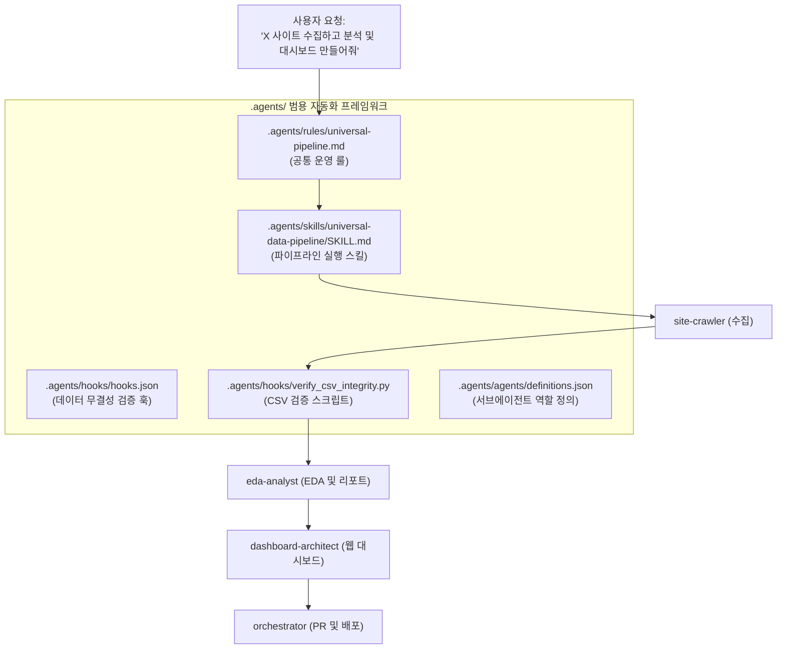

# [설계 및 구현 계획서] 범용 웹 수집·EDA·대시보드 자동화 프레임워크

교보문고 및 예스24 프로젝트를 통해 검증된 엔드투엔드 데이터 파이프라인을 체계화하여, **어떠한 신규 사이트(E-commerce, 포털, 채용, 부동산, 커뮤니티 등)라도 표준화된 방식으로 수집부터 인터랙티브 웹 대시보드 배포까지 완수할 수 있는 5대 핵심 커스터마이징 자산(Rule, Skill, Workflow, Hook, Subagents)**을 설계 및 구축합니다.

---

## 1. Goal Description (목표 설명)

본 프레임워크는 사용자가 *"새로운 사이트 X에서 자료를 수집하고 대시보드까지 만들어줘"*라고 요청했을 때, 일관된 품질과 안정성으로 아래 6개 단계를 자동으로 수행할 수 있는 재사용 가능한 아키텍처를 제공합니다:

1. **Step 1: 사이트 구조 및 통신 프로토콜 정밀 분석** (REST/GraphQL API 역공학 우선 탐색)
2. **Step 2: 스크래퍼 스크립트 작성 및 1차/전수 수집 검증** (`data/*.csv` UTF-8-SIG 저장)
3. **Step 3: 20년차 데이터 분석가 지침 기반 심층 EDA** (10종 이상 차트, TF-IDF 텍스트 마이닝, 기술통계 산출)
4. **Step 4: 고품질 종합 분석 보고서 발행** (`reports/EDA_Report.md`, 2,000자 이상 심층 인사이트)
5. **Step 5: 글래스모피즘 기반 Chart.js 인터랙티브 웹 대시보드 빌드** (`src/dashboard.html`)
6. **Step 6: Git 워크플로우 및 온라인 라이브 배포** (Issue, Branch, PR, GitHub Pages)

---

## 2. User Review Required (사용자 검토 필요 사항)

> [!IMPORTANT]
> **저장소 레벨 일체형 구성**:
> 모든 룰, 스킬, 훅, 서브에이전트 정의 파일은 프로젝트 루트의 `.agents/` 디렉터리 하위에 배치되어 Git 버전 관리에 포함되므로, 팀원이나 다른 환경에서도 클론 즉시 동일하게 작동합니다.

> [!TIP]
> **서브에이전트 동적 위임 체계**:
> 메인 에이전트가 단독으로 처리할 수도 있고, 대규모 작업 시에는 정의된 전문 서브에이전트(`site-crawler`, `eda-analyst`, `dashboard-architect`)를 `invoke_subagent`로 병렬 호출하여 컨텍스트 분리 및 작업 효율을 극대화할 수 있습니다.

---

## 3. Open Questions (인터뷰 합의 완료 사항)

- [x] **배치 형태**: 프로젝트 내 `.agents/` 디렉터리 기반 통합 프레임워크
- [x] **수집 엔진 전략**: 3단계 계층형 하이브리드 수집 (REST API 역공학 → 정적 HTML 파싱 → Playwright 브라우저 자동화)
- [x] **에이전트 구조**: 4단계 전문 분업 체계 (수집가, 분석가, 대시보드 아키텍트, 총괄 오케스트레이터)
- [x] **자동화 훅(Hooks)**: 필수 폴더 구조 가드 및 CSV 인코딩(UTF-8-SIG)/결측치 검증 자동화 훅

---

## 4. Proposed Changes (생성 및 변경 예정 파일 구조)

---

### Component 1: 룰 (Rules)
#### `[NEW]` `.agents/rules/universal-pipeline.md`
- **트리거**: `always_on` 또는 `model_decision`
- **핵심 내용**:
  1. 신규 사이트 프로젝트 착수 시 디렉터리 5대 표준(`data/`, `src/`, `images/`, `docs/`, `reports/`) 자동 생성 강제
  2. 공통 가상환경 `.venv` (uv) 필수 준수
  3. 사이트 조사 시 API 우선 탐색(역공학) 지침
  4. 데이터 저장 규격: UTF-8-SIG, 100% 결측치 검증
  5. 한국어 답변 및 주석, 워크스페이스 내 상대경로 사용 원칙

---

### Component 2: 스킬 (Skills)
#### `[NEW]` `.agents/skills/universal-data-pipeline/SKILL.md`
- **역할**: 임의의 웹사이트를 수집-분석-시각화-대시보드-배포하는 전 과정의 가이드라인 및 재사용 가능한 코드 템플릿 제공
- **포함 모듈**:
  - `templates/scraper_template.py`: GZIP 자동 해제, 재시도, 페이징 로직이 포함된 REST API 스크래퍼 뼈대
  - `templates/eda_template.py`: 10종 차트 자동 생성, 기술통계 및 Scikit-Learn TF-IDF 텍스트 마이닝 모듈
  - `templates/dashboard_template.html`: 화이트/다크 글래스모피즘 지원 Chart.js v4 인터랙티브 웹 대시보드 베이스
  - `templates/report_template.md`: 20년차 데이터 분석가 가이드라인에 따른 마크다운 리포트 템플릿

---

### Component 3: 훅 (Hooks)
#### `[NEW]` `.agents/hooks/hooks.json`
- **이벤트**: `PostToolUse` (파일 저장 `write_file` 실행 직후)
- **트리거 조건**: `kyobo/data/*.csv` 또는 `*/data/*.csv` 등 데이터 파일이 저장되었을 때
- **동작 스크립트**: `verify_csv_integrity.py`를 실행하여 UTF-8-SIG 인코딩, 빈 행 유무, 결측치 비율을 즉시 확인하고 리포트

#### `[NEW]` `.agents/hooks/verify_csv_integrity.py`
- CSV 파일의 유효성(BOM UTF-8, 헤더 컬럼 수 일치, 결측률)을 검증하고 결과를 JSON/텍스트로 표준 출력하는 독립 검증기

---

### Component 4: 서브에이전트 (Subagents)
#### `[NEW]` `.agents/agents/definitions.json` (및 `define_subagent` 연동)
1. **`site-crawler`**:
   - 역할: 네트워크 트래픽 분석, API 엔드포인트/헤더/파라미터 추출, 페이징 스크래퍼 작성 및 수집
2. **`eda-analyst`**:
   - 역할: 데이터 정제, 수치형/범주형 기술통계, TF-IDF 텍스트 분석, 10종 차트 생성, 마크다운 종합 리포트 작성
3. **`dashboard-architect`**:
   - 역할: Chart.js 기반 인터랙티브 차트 및 글래스모피즘 반응형 웹 대시보드 빌드
4. **`pipeline-orchestrator`**:
   - 역할: 전체 파이프라인 관리, Git 이슈 및 PR 생성, GitHub Pages 배포 연동

---

## 5. Verification Plan (검증 계획)

### Automated Tests (자동 검증)
1. **프레임워크 파일 구조 및 구문 검증**:
   - `.agents/rules/universal-pipeline.md`, `.agents/skills/universal-data-pipeline/SKILL.md`, `.agents/hooks/hooks.json` 파일 생성 여부 및 문법 확인
2. **무결성 훅 검증 스크립트 동작 테스트**:
   - `uv run python .agents/hooks/verify_csv_integrity.py kyobo/data/kyobo_daily_it_bestseller_20261021.csv` 실행하여 정상 593건 판정 검증

### Manual Verification (수동 검증)
1. 가상의 신규 사이트 시나리오(예: "알라딘 IT 베스트셀러" 또는 "네이버 IT 뉴스")에 본 프레임워크의 규칙과 템플릿을 대입했을 때 누락되는 단계가 없는지 워크플로우 무결성 점검
