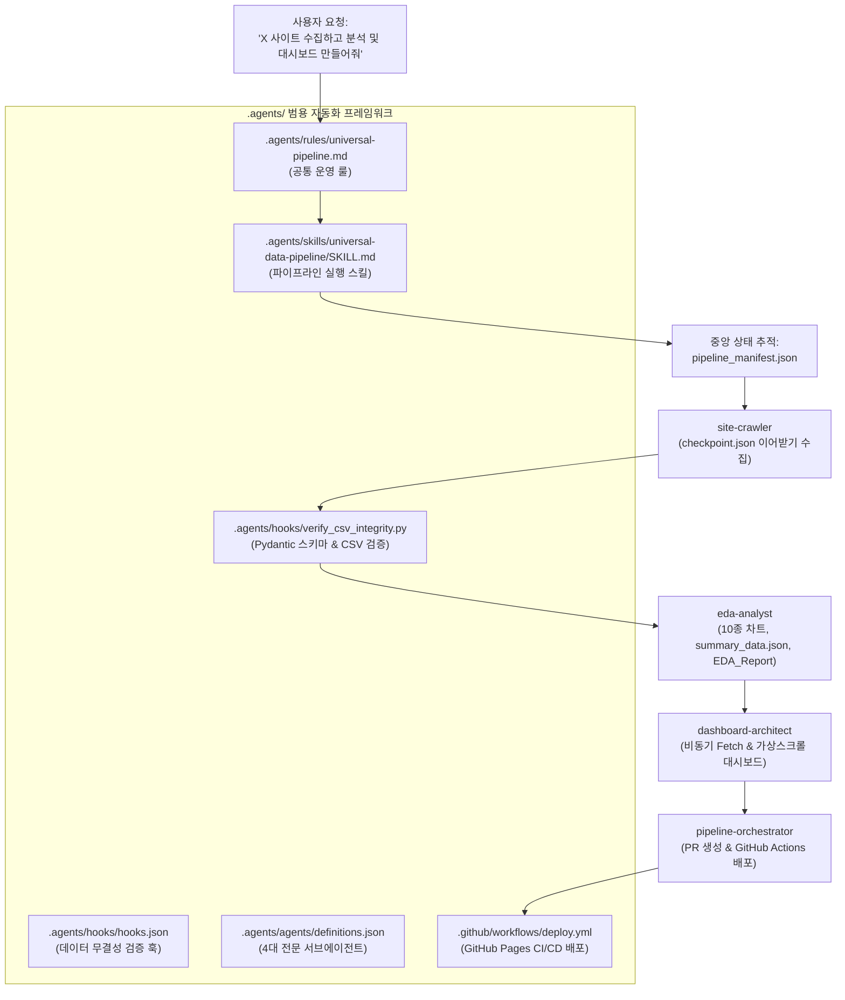

# [설계 및 구현 계획서] 범용 웹 수집·EDA·대시보드 자동화 프레임워크 (Hardened v2.0)

교보문고 및 예스24 프로젝트를 통해 검증된 엔드투엔드 데이터 파이프라인을 체계화하여, **어떠한 신규 사이트(E-commerce, 포털, 채용, 부동산, 커뮤니티 등)라도 표준화된 방식으로 수집부터 인터랙티브 웹 대시보드 배포까지 완수할 수 있는 5대 핵심 커스터마이징 자산(Rule, Skill, Workflow, Hook, Subagents)**을 설계 및 구축합니다.

---

## 1. Goal Description (목표 설명)

본 프레임워크는 사용자가 *"새로운 사이트 X에서 자료를 수집하고 대시보드까지 만들어줘"*라고 요청했을 때, 일관된 품질과 프로덕션 수준의 안정성으로 아래 6개 단계를 자동으로 수행할 수 있는 재사용 가능한 아키텍처를 제공합니다:

1. **Step 1: 사이트 구조 및 통신 프로토콜 정밀 분석**
   - REST/GraphQL API 역공학 우선 탐색 및 세션/헤더 동적 갱신 전략 수립
2. **Step 2: 복원력 높은 스크래퍼 구동 및 Pydantic 데이터 계약 검증**
   - `data/checkpoint.json` 상태 기반 이어받기 + 지수 백오프(Exponential Backoff with Jitter)
   - Pydantic 스키마 기반 엄격한 유효성 검증(Data Contract) 및 `data/*.csv` UTF-8-SIG 저장
3. **Step 3: 20년차 데이터 분석가 지침 기반 심층 EDA & 대시보드 데이터 사전 집계**
   - 10종 이상 고해상도 차트, TF-IDF 텍스트 마이닝, 기술통계 산출
   - 대용량 렌더링 최적화를 위한 경량 집계 요약 `data/summary_data.json` 사전 산출
4. **Step 4: 고품질 종합 분석 보고서 발행**
   - `reports/EDA_Report.md` (2,000자 이상 심층 비즈니스 인사이트 및 실행 전략)
5. **Step 5: 글래스모피즘 기반 Chart.js 비동기 웹 대시보드 빌드**
   - `src/dashboard.html` (요약 데이터 Fetch 비동기 로딩, 상세 테이블 가상 스크롤/페이징 적용)
6. **Step 6: Git 워크플로우 및 GitHub Actions CI/CD 라이브 배포**
   - 중앙 아티팩트 `pipeline_manifest.json` 기반 단계별 상태 추적 및 최종 검증
   - PR 생성 및 `.github/workflows/deploy.yml`을 통한 GitHub Pages 무중단 자동 배포

---

## 2. User Review Required (인터뷰 합의 완료 사항 및 설계 가드)

> [!IMPORTANT]
> **5대 핵심 보완 설계 확정 (/grill-me 결과 반영)**:
> 1. **수집 복원력**: `checkpoint.json` 기반 이어받기 및 401/403/429 대응 지수 백오프 + 세션 자동 갱신
> 2. **데이터 계약(Data Contract)**: Pydantic 모델을 통한 타입/범위/필수값 엄격 검증 및 스키마 드리프트 방어
> 3. **에이전트 오케스트레이션**: `pipeline_manifest.json` 중앙 상태 파일 기반 산출물 경로 및 실행 라이프사이클 공유
> 4. **대시보드 성능 최적화**: `summary_data.json` 분리 비동기 로딩(Fetch) 및 원천 데이터 테이블 가상 스크롤(Virtualization)
> 5. **CI/CD 거버넌스**: `.github/workflows/deploy.yml` 템플릿 내장 및 PR 머지 기반 GitHub Pages 무중단 자동 배포

> [!TIP]
> **저장소 레벨 일체형 구성**:
> 모든 룰, 스킬, 훅, 서브에이전트 정의 파일은 프로젝트 루트의 `.agents/` 디렉터리 하위에 배치되어 Git 버전 관리에 포함되므로, 팀원이나 다른 환경에서도 클론 즉시 동일하게 작동합니다.

---

## 3. Architecture & Agent Workflow (아키텍처 및 작업 흐름)

---

## 4. Proposed Changes (컴포넌트별 상세 구현 계획)

### Component 1: 룰 (Rules)
#### `.agents/rules/universal-pipeline.md`
- **트리거**: `always_on` 또는 `model_decision`
- **핵심 내용**:
  1. 신규 사이트 착수 시 5대 표준 디렉터리(`data/`, `src/`, `images/`, `docs/`, `reports/`) 자동 생성 강제
  2. 공통 가상환경 `.venv` (uv) 필수 준수
  3. 사이트 조사 시 REST/GraphQL API 우선 탐색 원칙
  4. 데이터 저장 규격: UTF-8-SIG 인코딩, Pydantic 스키마 검증 통과 필수
  5. 한국어 답변 및 주석, 워크스페이스 내 상대경로 사용 원칙

---

### Component 2: 스킬 (Skills)
#### `.agents/skills/universal-data-pipeline/SKILL.md`
- **역할**: 전 과정 가이드라인 및 재사용 가능한 모듈 템플릿 제공
- **포함 모듈 템플릿**:
  - `templates/scraper_template.py`: `checkpoint.json` 상태 관리, 지수 백오프, 세션 갱신 로직이 내장된 스크래퍼
  - `templates/schema_template.py`: 사이트별 엔티티를 정의하는 Pydantic Data Contract 모델 뼈대
  - `templates/eda_template.py`: 10종 고해상도 차트 생성, Scikit-learn TF-IDF 분석 및 `summary_data.json` 산출 모듈
  - `templates/dashboard_template.html`: 화이트/다크 글래스모피즘 지원, `summary_data.json` 비동기 로딩 및 가상 스크롤 대시보드
  - `templates/report_template.md`: 20년차 데이터 분석가 가이드라인에 따른 2,000자 이상 심층 보고서 템플릿
  - `templates/deploy_workflow.yml`: GitHub Actions를 통한 GitHub Pages 자동 빌드 및 배포 워크플로우

---

### Component 3: 훅 및 검증기 (Hooks & Validators)
#### `.agents/hooks/hooks.json`
- **이벤트**: `PostToolUse` (`write_file` 실행 직후)
- **트리거 조건**: `*/data/*.csv` 경로에 데이터가 기록되었을 때
- **동작**: `verify_csv_integrity.py`를 호출하여 무결성 자동 검사 수행

#### `.agents/hooks/verify_csv_integrity.py`
- UTF-8-SIG(BOM), 빈 행 유무, 결측률(0%) 기본 검사
- Pydantic 스키마 유효성 검증과 연동하여 필드 타입 및 이상치(범위 밖 데이터) 감지 시 리포트 출력

---

### Component 4: 서브에이전트 (Subagents)
#### `.agents/agents/definitions.json` (및 `pipeline_manifest.json` 인터페이스 연동)
1. **`site-crawler`**:
   - 역할: 프로토콜 분석, `checkpoint.json` 기반 이어받기 수집, Pydantic 스키마 1차 검증
2. **`eda-analyst`**:
   - 역할: 기술통계 산출, TF-IDF 분석, 10종 차트 생성, `summary_data.json` 및 `EDA_Report.md` 발행
3. **`dashboard-architect`**:
   - 역할: `summary_data.json` 비동기 로딩 기반 Chart.js 글래스모피즘 반응형 대시보드 구축
4. **`pipeline-orchestrator`**:
   - 역할: `pipeline_manifest.json` 상태 총괄, Git 브랜치/이슈/PR 생성 및 GitHub Actions 배포 연계

---

### Component 5: CI/CD 자동화 (Automation)
#### `.github/workflows/deploy.yml`
- PR 생성 시 CSV 무결성 검증 자동 실행
- `main` 브랜치 머지 시 `src/` 및 `data/` 아티팩트를 GitHub Pages 환경에 무중단 자동 배포

---

## 5. Verification Plan (검증 계획)

### Automated Tests (자동 검증)
1. **체크포인트 재개 검증**:
   - 수집 도중 강제 중단 시 `data/checkpoint.json`의 마지막 인덱스부터 누락 없이 이어받는지 확인
2. **Pydantic 스키마 데이터 계약 검증**:
   - 의도적 결측값 또는 비정상 타입 데이터 유입 시 검증기가 이를 감지하고 차단하는지 테스트
3. **대시보드 비동기 로딩 검증**:
   - `summary_data.json` 로딩 시 Chart.js 차트들이 에러 없이 렌더링되고 가상 스크롤이 작동하는지 브라우저 테스트
4. **CI/CD 워크플로우 문법 검증**:
   - `actionlint` 또는 YAML 문법 파서를 통한 워크플로우 구문 유효성 확인

### Manual Verification (수동 검증)
- 임의의 신규 사이트(예: 알라딘 베스트셀러, 채용공고 등) 시나리오에 적용하여 전 과정 자동 수행 흐름 점검
