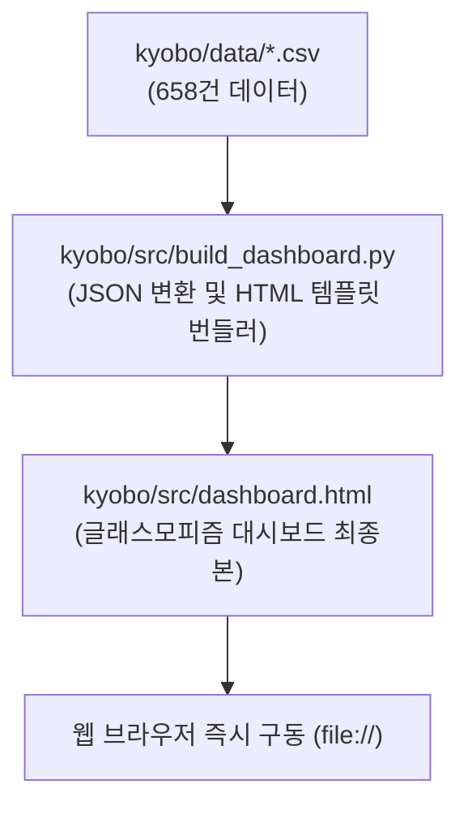

# [구현 계획서] 교보문고 IT 베스트셀러 글래스모피즘 웹 대시보드 구축

- **연동 깃허브 이슈**: [Issue #3: [FEAT] 교보문고 IT 베스트셀러 글래스모피즘 웹 대시보드 (Chart.js) 구축](https://github.com/CodeZ00/DATACRAWLING/issues/3)
- **작성 일자**: 2026-10-21
- **대상 브랜치**: `feat/kyobo-glassmorphism-dashboard`

---

## 1. Goal Description (목표 설명)

교보문고 컴퓨터/IT 부문 일간 베스트셀러 658건의 수집 및 EDA 결과를 바탕으로, 별도의 백엔드 서버 없이 브라우저에서 로컬 파일(`file://`)로 즉시 열리는 고성능 글래스모피즘(Glassmorphism) 기반 Chart.js 인터랙티브 웹 대시보드([kyobo/src/dashboard.html](file:///C:/FTC_downloads/Antigravity_project/myfirst_project/DATACRAWLING/kyobo/src/dashboard.html))를 구축합니다.

사용자 편의성을 위해 658건의 정제된 데이터를 HTML 파일 내에 안전하게 인라인 임베드하여 브라우저 CORS 제약 없이 동작하도록 하며, 실시간 검색, 다중 필터링, 컬럼별 정렬, 페이징 테이블 및 도서 상세 모달 기능을 제공합니다.

---

## 2. User Review Required (사용자 검토 필요 사항)

> [!IMPORTANT]
> **CDN 의존성 안내**:
> Tailwind CSS(v3 Play CDN), Chart.js(v4.4), Pretendard 폰트, Lucide Icons를 외부 CDN으로부터 로드합니다. 최초 실행 시 인터넷 연결이 필요합니다.

> [!NOTE]
> **단일 파일 배포**:
> 모든 HTML, CSS(Glassmorphism), JavaScript(Chart.js 연동 및 데이터 상태 관리), JSON 데이터셋이 `kyobo/src/dashboard.html` 단일 파일에 번들링되어 전달되므로 복사/이동 및 실행이 매우 간편합니다.

---

## 3. Open Questions (확인된 결정 사항)

- [x] **데이터 범위**: 교보문고 컴퓨터/IT 베스트셀러 658건 단독 대시보드 (인터뷰 합의 완료)
- [x] **구동 방식**: 별도 백엔드 실행 없는 독립형 정적 웹 앱 (인터뷰 합의 완료)
- [x] **디자인 테마**: 앰비언트 글로우 배경 + 반투명 블러 패널의 **글래스모피즘(Glassmorphism)** (사용자 요청 반영)
- [x] **시각화 라이브러리**: **Chart.js** 6대 핵심 차트 구현 (사용자 요청 반영)
- [x] **파일 위치**: `kyobo/src/dashboard.html` (인터뷰 합의 완료)

---

## 4. Proposed Changes (변경 예정 파일 목록)



---

### Component: Dashboard Builder & HTML

#### `[NEW]` [kyobo/src/build_dashboard.py](file:///C:/FTC_downloads/Antigravity_project/myfirst_project/DATACRAWLING/kyobo/src/build_dashboard.py)
- CSV 데이터를 파싱하여 특수문자 및 따옴표를 정제한 컴팩트 JSON 데이터를 생성
- 글래스모피즘 UI 템플릿에 데이터를 인라인 주입하여 `kyobo/src/dashboard.html`을 생성하는 빌더 스크립트

#### `[NEW]` [kyobo/src/dashboard.html](file:///C:/FTC_downloads/Antigravity_project/myfirst_project/DATACRAWLING/kyobo/src/dashboard.html)
- **Glassmorphism Styling**:
  - 오로라 메시 그라데이션 백그라운드
  - `backdrop-blur-md`, 반투명 화이트 보더(`border-white/10`), 반투명 글래스 패널(`bg-slate-900/40`)
- **Key Metrics (KPI Cards)**:
  - 총 도서수(658), 평균 판매가(24,955원), 평균 평점(8.13점), 최다 리뷰 도서(469건)
- **Chart.js 6대 인터랙티브 차트**:
  1. 가격대 구간별 도서 분포 (Bar Chart)
  2. 상위 10대 출판사 시장 점유율 (Doughnut Chart)
  3. 출간 연도별 신간 진입 추이 (Line & Area Chart)
  4. 순위 구간별 평균 리뷰 수 (Bar Chart)
  5. 평점 구간별 도서 분포 (Polar Area Chart)
  6. TF-IDF 상위 핵심 키워드 Top 15 (Horizontal Bar Chart)
- **데이터 그리드 & 탐색 컨트롤러**:
  - 실시간 도서명/저자/출판사 검색 필터
  - 출판사 드롭다운 필터
  - 가격대 필터
  - 순위/가격/평점/리뷰수 헤더 클릭 정렬
  - 10/20/50개 단위 반응형 페이지네이션
  - 도서 클릭 시 슬라이드오버/모달 상세 정보 팝업

---

## 5. Verification Plan (검증 계획)

### Automated Tests (자동 검증)
1. **HTML 파일 생성 및 크기 검증**:
   - `build_dashboard.py` 실행 후 `kyobo/src/dashboard.html` 파일 존재 및 658건 데이터 포함 여부 확인
   ```powershell
   uv run python kyobo/src/build_dashboard.py
   Test-Path "kyobo/src/dashboard.html"
   ```

2. **JSON 데이터 무결성 검증**:
   - 인라인 임베드된 JSON 데이터의 구문 오류(`SyntaxError`)가 없는지 확인

### Manual Verification (수동 검증)
1. 생성된 `kyobo/src/dashboard.html`을 기본 웹 브라우저(Chrome/Edge)로 실행
2. 상단 4개 KPI 카드의 수치가 정상 표출되는지 확인
3. 6개 Chart.js 차트가 애니메이션과 함께 정상 렌더링되고 마우스 호버 시 툴팁이 동작하는지 확인
4. 검색창에 '클로드' 또는 '시나공' 입력 시 데이터 테이블이 즉각 필터링되는지 확인
5. 출판사 필터 및 정렬 기능이 원활하게 작동하는지 확인
