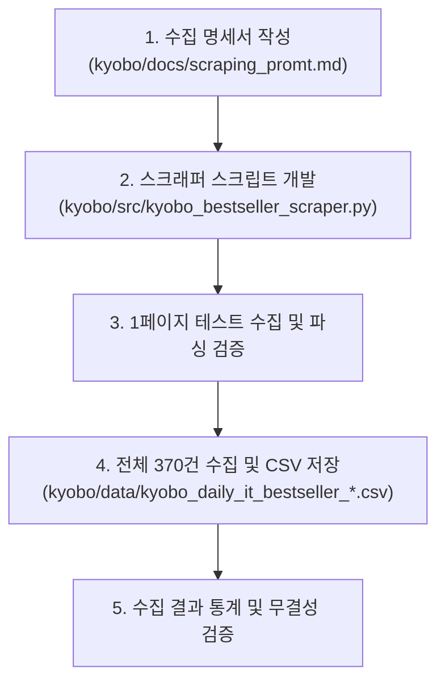

# 교보문고 컴퓨터/IT 베스트셀러 데이터 수집 및 명세서 구축 계획

교보문고의 컴퓨터/IT 분야 온라인 일간 베스트셀러 목록 전체(약 370건)를 내부 REST API를 활용하여 효율적이고 안정적으로 수집하고, `kyobo/docs/scraping_promt.md` 명세서 작성 및 CSV 파일 저장을 자동화하는 구현 계획입니다.

---

## 1. 개요 및 배경
- **대상 페이지**: [교보문고 컴퓨터/IT 일간 베스트](https://store.kyobobook.co.kr/bestseller/online/daily/domestic/33?page=1)
- **수집 방식**: 교보문고 공식 프론트엔드가 사용하는 내부 REST Gateway API 직접 호출 (`https://store.kyobobook.co.kr/api/gw/best/best-seller/online`)
- **전체 규모**: 총 370건 내외 (페이지당 50건씩 8회 요청)
- **저장 위치**: `kyobo/data/kyobo_daily_it_bestseller_{YYYYMMDD}.csv` (UTF-8-SIG 인코딩으로 엑셀 호환)

---

## 2. API 규격 및 파라미터 설계

### 2.1 HTTP 요청 정보
- **URL**: `https://store.kyobobook.co.kr/api/gw/best/best-seller/online`
- **Method**: `GET`
- **헤더**:
  - `User-Agent`: 일반 데스크톱 Chrome UA
  - `Referer`: `https://store.kyobobook.co.kr/bestseller/online/daily/domestic/33?page=1`
  - `Accept`: `application/json, text/plain, */*`

### 2.2 쿼리 파라미터 (Payload)
| 파라미터명 | 기본값 | 설명 |
| :--- | :--- | :--- |
| `page` | 1 ~ N | 페이지 번호 |
| `per` | 50 | 페이지당 도서 수 (최대 50) |
| `period` | `001` | 집계 주기 (`001`: 일간) |
| `dsplDvsnCode` | `001` | 상품 구분 (`001`: 국내도서) |
| `dsplTrgtDvsnCode` | `004` | 전시 대상 (`004`: 특정 카테고리) |
| `saleCmdtClstCode` | `33` | 카테고리 코드 (`33`: 컴퓨터/IT) |

> [!NOTE]
> 응답 데이터는 서버에서 GZIP 압축(`0x1f 0x8b`)되어 반환되므로 자동 압축 해제 처리가 필요합니다.

---

## 3. 수집 데이터 컬럼 스키마 (15개 필드)

| 번호 | 컬럼명 (영문) | 컬럼명 (한글) | 소스 필드 | 예시 데이터 |
| :--- | :--- | :--- | :--- | :--- |
| 1 | `rank` | 순위 | `prstRnkn` | 1 |
| 2 | `prev_rank` | 이전순위 | `frmrRnkn` | 1 |
| 3 | `book_id` | 상품ID | `saleCmdtid` | `S000218736039` |
| 4 | `title` | 도서명 | `cmdtName` | 2026 이지패스 ADsP 데이터분석 준전문가 |
| 5 | `author` | 저자 | `chrcName` | 박현민 외 |
| 6 | `publisher` | 출판사 | `pbcmName` | 위키북스 |
| 7 | `pub_date` | 출간일 | `rlseDate` | `20260102` |
| 8 | `fixed_price` | 정가 | `price` | 30000 |
| 9 | `sale_price` | 판매가 | `sapr` | 27000 |
| 10 | `discount_rate` | 할인율(%) | `dscnRate` | 10 |
| 11 | `point` | 적립포인트 | `upntAcmlAmnt` | 1500 |
| 12 | `review_count` | 리뷰수 | `buyRevwNumc` | 398 |
| 13 | `rating` | 리뷰평점 | `buyRevwRvgr` | 9.86 |
| 14 | `isbn` | ISBN | `cmdtCode` | `9791158396510` |
| 15 | `intro` | 도서소개 | `inbukCntt` | HTML 태그 정제 텍스트 |

---

## 4. 작업 계획 (Step-by-step)

### Step 1: 명세서 작성
- `kyobo/docs/scraping_promt.md` 파일에 HTTP 요청 정보, 파라미터, 응답 JSON 샘플 및 수집 요구사항 명세 작성 (기존 yes24 프로젝트 형식 반영)

### Step 2: 스크래퍼 스크립트 작성
- `kyobo/src/kyobo_bestseller_scraper.py` 작성
- 규칙 준수: 한국어 docstring, 워크스페이스 내 상대경로 사용, uv 환경 호환 표준 라이브러리(`urllib`, `gzip`, `json`, `csv`) 활용

### Step 3: 실행 및 검증
- 1페이지 시범 수집 후 전체 페이지(1~8페이지) 순차 수집
- `kyobo/data/` 디렉터리에 UTF-8-SIG CSV 파일 저장
- 총 건수, 결측치, 순위 연속성 검증

---

## 5. 검증 계획 (Verification Plan)

### 자동 검증
- 스크래퍼 실행 완료 후 생성된 CSV 파일의 행 수(`RowCount`)가 전체 도서 수(`total` 약 370건)와 일치하는지 확인
- 컬럼 헤더 15개가 정확히 생성되었는지 확인
- 순위(`rank`) 필드가 1위부터 결측 없이 이어지는지 검증

### 수동 검증
- CSV 파일 일부를 열어 엑셀 한글 깨짐 없이 정상 출력되는지 확인
