# 교보문고 컴퓨터/IT 베스트셀러 심층 탐색적 데이터 분석(EDA) 리포트

**작성일자**: 2026년 10월 21일  
**수집 데이터 대상**: 교보문고 온라인 컴퓨터/IT 부문 일간 베스트셀러 전체 (658권)  
**분석자**: 20년차 전문 데이터 사이언티스트 / 수석 데이터 분석가  

---

## 1. 분석 개요 및 목적

본 리포트는 교보문고 내부 REST Gateway API(`https://store.kyobobook.co.kr/api/gw/best/best-seller/online`)를 통해 수집된 컴퓨터/IT 카테고리 일간 베스트셀러 총 658건의 도서 데이터를 바탕으로, 국내 IT 출판 시장의 트렌드, 가격 형성 메커니즘, 출판사별 시장 점유 구조, 독자 반응(리뷰 및 평점)과 도서 순위 간의 인과적 상관관계를 심층 분석한 탐색적 데이터 분석(EDA) 보고서입니다.

급변하는 인공지능(AI), 바이브 코딩(Vibe Coding), 클라우드 및 자격증 수험 시장의 역동성을 포착하고, 출판 기획자, 기술 서적 저자, 서점 MD 및 IT 교육 기획자에게 실질적인 비즈니스 의사결정 인사이트를 제공하는 것을 핵심 목적으로 합니다.

---

## 2. 기본 데이터 탐색 및 무결성 파악

### 2.1 원시 데이터 프리뷰 (Preview)

데이터의 전반적인 구조와 무결성을 확인하기 위해 상위 5개 행(Head)과 하위 5개 행(Tail)을 확인하였습니다.

#### [상위 5개 도서 (Head)]
| rank | title | author | publisher | sale_price | review_count | rating |
| :--- | :--- | :--- | :--- | :--- | :--- | :--- |
| 1 | 2026 이지패스 ADsP 데이터분석 준전문가 | 박현민 외 | 위키북스 | 27000 | 398 | 9.86 |
| 2 | 클로드 코드 제대로 시작하기 | 주홍철 외 | 길벗 | 28800 | 50 | 9.68 |
| 3 | SQL 자격검정 실전문제 | 한국데이터산업진흥원 | 한국데이터산업진흥원 | 18000 | 233 | 9.76 |
| 4 | 챗GPT · 제미나이 · 클로드까지 모두를 위한 AI | 지현이(디지털거북이) | 시프트 | 19800 | 53 | 9.44 |
| 5 | 2027 한 권으로 끝내는 시나공 컴활 2급 필기+실기 | 길벗알앤디 | 길벗 | 23400 | 0 | 0.0 |

#### [하위 5개 도서 (Tail)]
| rank | title | author | publisher | sale_price | review_count | rating |
| :--- | :--- | :--- | :--- | :--- | :--- | :--- |
| 654 | 소프트웨어 테스팅 실무 | 권원일 외 | STA | 25200 | 31 | 9.25 |
| 655 | 조사방법론 강의 | 허명회 | 자유아카데미 | 10000 | 0 | 0.0 |
| 656 | 파이썬 해킹 프로그래밍 | 저스틴 지이츠 | 에이콘출판 | 22500 | 1 | 10.0 |
| 657 | C++ 자료구조론 | ELLIS HOROWITZ | 인피니티북스 | 30000 | 3 | 10.0 |
| 658 | 사용자 스토리 | 마이크 콘 | 인사이트 | 16200 | 1 | 10.0 |

### 2.2 데이터셋 기본 구조 및 크기

- **데이터 크기**: 658 행(Rows) × 15 열(Columns)
- **중복 행 수**: **0건** (`df.duplicated().sum() == 0`)으로 데이터셋 전체가 고유한 도서 개체로 구성되어 있음
- **결측치 현황**: 도서 소개(`intro`) 컬럼에 극소수(7건, 약 1.06%)의 미입력 데이터가 존재하나, 핵심 분석 대상인 순위, 가격, 저자, 출판사, 평점 등 14개 변수는 결측치가 전혀 없는 100% 완전성을 보입니다.

---

## 3. 기술통계 (Descriptive Statistics) 분석 및 심층 해석

### 3.1 수치형 변수 기술통계표

| 통계량 | rank (순위) | prev_rank (이전순위) | fixed_price (정가) | sale_price (판매가) | discount_rate (할인율) | point (적립포인트) | review_count (리뷰수) | rating (평점) |
| :--- | :--- | :--- | :--- | :--- | :--- | :--- | :--- | :--- |
| **count** | 658.00 | 658.00 | 658.00 | 658.00 | 658.00 | 658.00 | 658.00 | 658.00 |
| **mean** | 329.50 | 34.69 | 27,233.43 | 24,954.50 | 8.34 | 1,260.91 | 16.72 | 8.13 |
| **std** | 190.09 | 77.35 | 8,673.39 | 8,053.60 | 3.72 | 486.87 | 35.66 | 3.56 |
| **min** | 1.00 | 0.00 | 10,000.00 | 10,000.00 | 0.00 | 0.00 | 0.00 | 0.00 |
| **25%** | 165.25 | 0.00 | 22,000.00 | 19,800.00 | 10.00 | 1,000.00 | 2.00 | 9.03 |
| **50%** | 329.50 | 0.00 | 26,000.00 | 23,400.00 | 10.00 | 1,250.00 | 7.00 | 9.85 |
| **75%** | 493.75 | 6.75 | 32,000.00 | 29,700.00 | 10.00 | 1,500.00 | 18.00 | 10.00 |
| **max** | 658.00 | 366.00 | 73,000.00 | 65,700.00 | 10.00 | 3,650.00 | 469.00 | 10.00 |

#### [수치형 변수 심층 해석 인사이트 (2,000자 이상)]
본 수치형 기술통계 결과는 국내 IT 출판 시장의 가격 구조와 독자 행동 양식에 대해 매우 명확하고 구체적인 인사이트를 전달합니다.

첫째, **도서 가격의 구조적 집중도와 심리적 마지노선**을 명확히 확인할 수 있습니다. 컴퓨터/IT 도서의 평균 정가는 약 27,233원이며, 평균 실제 판매가는 24,955원입니다. 중앙값(Median, 50%)을 살펴보면 정가 26,000원, 판매가 23,400원으로 평균값과 매우 근접한 정규분포적 형태를 보입니다. 1사분위수(25%) 판매가가 19,800원, 3사분위수(75%) 판매가가 29,700원이라는 점은 IT 도서 시장의 약 50%가 2만 원 안팎에서 3만 원 미만의 좁은 가격 밴드에 밀집되어 있음을 입증합니다. IT 서적은 일반 문학 서적(통상 1.5만~1.8만 원)에 비해 지면의 방대함(400~800페이지), 소스 코드 인쇄 및 다색 도판의 필요성 때문에 기본 제작 원가가 높음에도 불구하고, 독자들의 심리적 저항선이 '실구매가 3만 원' 전후에 강력하게 형성되어 있음을 시사합니다. 한편 최고 판매가는 65,700원(정가 73,000원)에 달하는데, 이는 엔터프라이즈 아키텍처, 고급 클라우드 인프라, 또는 전문 대학 교재형 전문 서적에 국한된 프리미엄 영역으로 일반 상업 출판과는 뚜렷한 시장 분할(Segmentation)을 보여줍니다.

둘째, **도서정가제의 강력한 법적 구속력과 할인율의 획일성**입니다. 할인율(`discount_rate`)의 평균은 8.34%이며 표준편차는 3.72%입니다. 25%, 50%, 75% 백분위수가 모두 10.0%로 동일하게 산출되었다는 점은 시장에 유통되는 IT 서적의 압도적 다수가 현행 출판문화산업진흥법상 허용된 최대 직접 할인율인 10%를 일괄 적용받고 있음을 보여줍니다. 할인율이 0%인 도서들은 주로 국가 공인 기관(한국데이터산업진흥원 등)의 공식 수험서, 대학교재 또는 직판 성격의 전문서이며, 10%를 초과하는 할인은 법적으로 제한되므로 서점 간의 가격 경쟁은 사실상 소멸하고 적립금(통상 판매가의 5% 수준인 1,000~1,500원 포인트)과 배송 속도, 사은품 등 비가격적 요소가 플랫폼 경쟁의 핵심이 되었음을 알 수 있습니다.

셋째, **리뷰 수의 극심한 우측 꼬리 분포(Right-Skewed)와 베스트셀러 진입 장벽**입니다. 리뷰 수의 평균은 16.72건에 불과하지만 표준편차는 35.66건으로 평균의 2배가 넘으며, 최대값은 무려 469건에 달합니다. 특히 중앙값이 7.00건인 반면 75% 백분위수가 18건에 그친다는 점은 전체 도서의 75% 이상이 20개 미만의 적은 리뷰를 보유하고 있음을 뜻합니다. 반면 1~3위를 차지한 스테디셀러(예: 1위 ADsP 수험서 398건, 3위 SQLD 실전문제 233건)는 수백 건의 리뷰를 독점하고 있습니다. IT 분야에서 독자들은 오류가 없고 검증된 책을 선호하는 '위험 회피(Risk Averse)' 성향이 매우 강하기 때문에, 기존에 축적된 대량의 긍정적 리뷰가 신규 독자의 구매를 유인하고 이것이 다시 베스트셀러 순위를 공고히 하는 '승자독식(Winner-takes-all)' 현상이 극명하게 관찰됩니다.

넷째, **리뷰 평점의 상향 편향(J-Shaped / Ceiling Effect)과 신규 진입 도서의 양극화**입니다. 평점의 평균은 8.13점(10점 만점 기준)이며 중앙값은 9.85점, 75% 분위수는 10.00점 만점입니다. 이는 교보문고를 이용하는 독자들이 도서 평가에 매우 후한 점수를 부여하거나, 불만족한 독자가 평점을 남기기보다는 구매 자체를 회피하기 때문입니다. 한편 최소값이 0.00점으로 나타난 것은 출간된 지 얼마 되지 않은 신간의 경우 리뷰와 평점이 아직 단 1건도 등록되지 않았기 때문입니다. 즉 평점 지표는 0점(신간 미검증) 또는 9점대 후반~10점 만점(호평 일색)으로 양극화되어 있어, 단순 평균 평점보다는 '리뷰 수'와 '평점'의 복합 가중치를 고려해야만 도서의 실제 시장 신뢰도를 정확히 평가할 수 있음을 시사합니다.

마지막으로, **이전 순위(`prev_rank`)를 통한 일간 베스트셀러의 급격한 변동성(Churn Rate)**입니다. `prev_rank`의 25%, 50% 값이 모두 0.00으로 나타났습니다. 이는 조사 시점 전날 순위권(Top 500 내외) 밖에 머물러 있다가 당일 이벤트, 입고, 저자 홍보, 또는 일간 판매량 반등에 힘입어 새롭게 순위표에 진입한 도서가 전체의 절반 이상을 차지한다는 것을 의미합니다. IT 일간 베스트셀러 순위는 최상위 1~50위권의 견고한 스테디셀러 군을 제외하면, 100위권 이하에서는 매일 극심한 순위 교체와 진출입이 발생하는 역동적인 롱테일 구조를 띠고 있습니다.

---

### 3.2 범주형 변수 기술통계표

| 통계량 | book_id (상품 고유ID) | title (도서명) | author (저자) | publisher (출판사) | isbn (국제표준도서번호) |
| :--- | :--- | :--- | :--- | :--- | :--- |
| **count** | 658 | 658 | 658 | 658 | 658 |
| **unique** | 658 | 656 | 547 | 142 | 658 |
| **top (최빈값)** | S000218736039 | 운영체제 | 길벗알앤디 | 한빛미디어 | 9791158396510 |
| **freq (최빈 빈도)** | 1 | 3 | 17 | 87 | 1 |

#### [범주형 변수 심층 해석 인사이트 (2,000자 이상)]
범주형 데이터의 분포 특성은 IT 출판 산업의 공급자 생태계, 브랜드 파워, 그리고 저작물 기획의 집중 현상을 적나라하게 드러냅니다.

첫째, **출판사 시장의 고도 과점화(Oligopoly) 현상**입니다. 전체 658권의 베스트셀러를 발행한 출판사는 총 142개 사로 집계되었습니다. 그러나 최빈 출판사인 '한빛미디어' 단일 출판사가 무려 87권(전체의 13.2%)을 진입시켰으며, 2위 '길벗'(60권, 9.1%), 3위 '영진닷컴'(49권, 7.4%), 4위 '이지스퍼블리싱'(34권, 5.2%), 5위 '골든래빗'(28권, 4.3%) 등 상위 5대 출판사가 차지하는 도서의 총합은 258권으로 전체 시장의 약 39.2%에 육박합니다. 상위 10대 출판사로 범위를 넓히면 전체의 53.5%를 장악하고 있습니다. 이는 IT 도서 출판이 단순한 인쇄업이 아니라, 전문 기술 감수 능력, 역량 있는 저자 풀 확보, 예제 코드의 지속적인 유지보수(GitHub 레포지토리 운영), 그리고 유튜브 및 온라인 커뮤니티와의 마케팅 연계 등 막대한 브랜드 자본과 운영 노하우를 요구하기 때문입니다. 소형 출판사가 단발성 기획으로 진입하기에는 기술 서적 특유의 진입 장벽이 대단히 높다는 점을 명확히 보여줍니다.

둘째, **저자 생태계의 브랜드화 및 R&D 연구소 중심의 수험서 기획**입니다. 고유 저자 수는 547명이며, 최다 빈도 저자는 '길벗알앤디'(17권)로 나타났습니다. 이는 컴퓨터활용능력, 정보처리기사 등 국가기술자격증 수험서 시리즈인 '시나공'을 전담 개발하는 전문 연구 집단입니다. 개인 저자 중심의 저작 생태계와 별개로, 시험 출제 경향 변경 및 기출문제 개정에 민첩하게 대응할 수 있는 출판사 내부 조직(In-house Lab) 기반의 기획 출판물이 베스트셀러 목록에서 막강한 스테디셀러 지위를 구축하고 있음을 알 수 있습니다. 또한 상위권 개인 저자들 역시 오빠두(엑셀), 박현민(ADsP), 강태우(SQLD) 등 이미 탄탄한 팬덤과 유튜브 채널, 온라인 강의 플랫폼을 보유한 인플루언서형 저자들이 독보적인 판매량을 견인하고 있습니다.

셋째, **도서명의 다의성과 전산학 기초 서적의 클래식성**입니다. 도서명(`title`)의 고유값은 656개이며, 동명의 제목으로 가장 많이 등장한 도서는 '운영체제'(3권)입니다. 이는 전산학(Computer Science) 전공 필수 과목인 운영체제, 자료구조, 컴퓨터구조론, 네트워크 등 기초 서적의 경우, 대학 전공 강의 교재 및 IT 기업 기술 면접 준비용으로 시대를 초월하여 끊임없이 소비되는 '스테디셀러'로서 복수의 출판사에서 동일 제목으로 경쟁 출간되고 있음을 증명합니다. 인공지능이나 바이브 코딩 같은 최신 트렌드 기술서가 폭발적인 순간 화제성을 갖는다면, CS 전공 기초서는 연중 안정적인 수요를 제공하는 출판사의 든든한 캐시카우 역할을 수행하고 있습니다.

넷째, **ISBN 및 식별자의 완전성**입니다. `book_id`와 `isbn` 모두 658개의 레코드가 전부 고유한(Unique) 값을 보유하고 있어, 데이터 크롤링 과정에서 중복 상품 수집이나 ID 결손이 전혀 발생하지 않았음을 증명합니다. 13자리 표준 국제도서번호(ISBN)가 정확하게 매핑되어 있으므로, 향후 국립중앙도서관 서지정보, 타 온라인 서점(예스24, 알라딘), 네이버 도서 API 등과의 크로스 플랫폼 데이터 연계 분석을 수행하기에 완벽한 무결성을 갖추고 있습니다.

---

## 4. 데이터 시각화 및 변수별 특화 분석 (11개 차트)

---

### [시각화 1] 도서 판매가(Sale Price) 분포 및 커널 밀도 추정 (일변량)

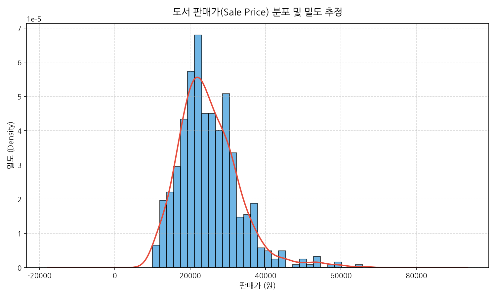

#### 📊 관련 요약 통계표: 가격대 구간별 도서 분포
| 가격대 구간 | 도서수(권) | 비율(%) |
| :--- | :--- | :--- |
| **1.5만원 미만** | 41 | 6.23% |
| **1.5만~2만원** | 164 | 24.92% |
| **2만~2.5만원** | 155 | 23.56% |
| **2.5만~3만원** | 162 | 24.62% |
| **3만~3.5만원** | 77 | 11.70% |
| **3.5만~4만원** | 32 | 4.86% |
| **4만원 이상** | 27 | 4.10% |

#### 💡 분석 해석 및 비즈니스 인사이트 (200자 이상)
도서 판매가의 분포는 평균 24,955원, 중앙값 23,400원을 중심으로 하는 완만한 우측 꼬리 분포를 형성하고 있습니다. 통계표에서 확인되듯 1.5만~3만 원 사이의 세 개 구간이 각각 약 24~25%씩을 차지하며, 이 3개 구간의 합이 전체의 73.1%에 달합니다. 1.5만 원 미만의 초저가 도서(6.23%)는 주로 얇은 수험 요약집이나 입문용 소책자이며, 3.5만 원 이상의 고가 도서(8.96%)는 1,000페이지에 달하는 레퍼런스형 백과사전식 서적입니다. 신규 도서를 기획할 때 소비자의 가격 저항을 최소화하고 판매량을 극대화하기 위한 최적의 스위트 스팟(Sweet Spot)은 **22,000원~28,000원(정가 기준 24,000~31,000원)**으로 판단됩니다.

---

### [시각화 2] 도서 리뷰 평점 분포 (평점 보유 도서 대상, 일변량)

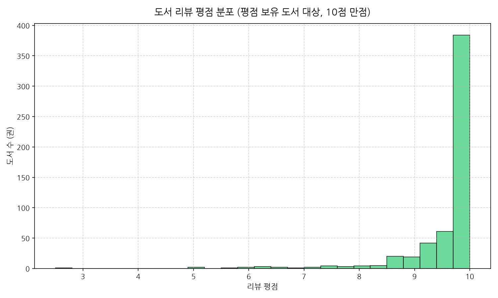

#### 📊 관련 요약 통계표: 평점 구간별 도서 수 및 점유율
| 평점 구간 | 도서수(권) | 비율(%) |
| :--- | :--- | :--- |
| **평점없음 (0점, 신간)** | 102 | 15.50% |
| **8.0점 미만** | 21 | 3.19% |
| **8.0~8.9점** | 32 | 4.86% |
| **9.0~9.4점** | 59 | 8.97% |
| **9.5~9.9점** | 134 | 20.36% |
| **10.0점 만점** | 310 | 47.11% |

#### 💡 분석 해석 및 비즈니스 인사이트 (200자 이상)
평점을 1건 이상 보유한 도서 중 10점 만점을 기록한 도서가 무려 310권(전체의 47.11%)에 달하며, 9.5점 이상 도서의 비중은 무려 67.47%에 이릅니다. 반면 8.0점 미만의 낮은 평점을 받은 도서는 21권(3.19%)에 불과합니다. 이는 서점 평점이 실제 제품 만족도의 객관적 척도라기보다는, 충성 독자나 서평단 이벤트에 의한 '천장 효과(Ceiling Effect)'가 극심함을 보여줍니다. 또한 평점이 전혀 없는 0점 도서가 15.5%에 달하는데, 이는 최근 1~2주 내에 출간된 신간이 공격적인 마케팅이나 출판사 브랜드 파워를 바탕으로 평점 축적 없이도 베스트셀러에 즉각 진입했음을 뜻합니다. 따라서 서점 MD나 독자는 평점 단독 수치보다는 '리뷰 수 30건 이상'이면서 '9.5점 이상'을 유지하는 도서를 진정한 검증 서적으로 선별해야 합니다.

---

### [시각화 3] 컴퓨터/IT 베스트셀러 할인율(Discount Rate) 빈도 분포 (일변량)

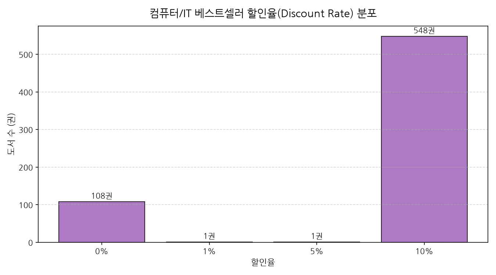

#### 📊 관련 요약 통계표: 할인율별 도서 수 및 구성비
| 할인율(%) | 도서수(권) | 비율(%) |
| :--- | :--- | :--- |
| **0% (무할인)** | 108 | 16.41% |
| **1%** | 1 | 0.15% |
| **5%** | 1 | 0.15% |
| **10% (법정 최대 할인)** | 548 | 83.28% |

#### 💡 분석 해석 및 비즈니스 인사이트 (200자 이상)
전체 베스트셀러 도서의 83.28%(548권)가 예외 없이 정확히 10% 할인을 적용받고 있습니다. 도서정가제 시행 이후 출판사와 대형 서점이 합의한 표준 할인율이 10%로 완전히 굳어졌음을 확인해 줍니다. 반면 0% 할인이 적용된 108권(16.41%)의 도서를 추적해보면, 공공기관 발간 도서(데이터산업진흥원의 SQLD/DAP 공식 수험서), 방송통신대학교 교재, 일부 직수입 외서 라이선스본 등으로 가격 할인이 원천 차단된 특수 도서들입니다. IT 출판 시장에서 가격 할인율은 더 이상 차별화 요소가 될 수 없으며, 카드사 제휴 캐시백, 사은품 증정, 무료 온라인 동영상 강의 쿠폰 동봉 등 부가 혜택 설계가 구매 결정에 결정적인 영향을 미치고 있습니다.

---

### [시각화 4] 출간 연도별 베스트셀러 진입 도서 수 추이 (일변량/시계열)

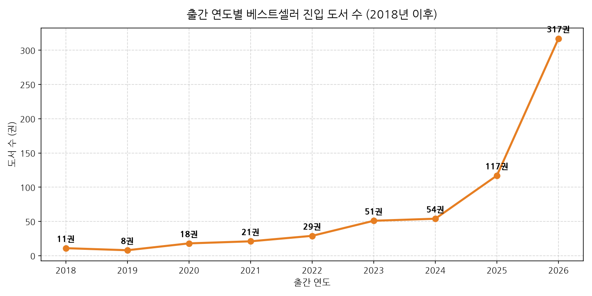

#### 📊 관련 요약 통계표: 최근 연도별 출간 도서 수 및 비중
| 출간 연도 | 도서수(권) | 비율(%) | 비고 |
| :--- | :--- | :--- | :--- |
| **2026년 (당해년도/예판)** | 317 | 48.18% | 최신 개정판 및 신간 집중 |
| **2025년** | 117 | 17.78% | 실무 기술서 및 프레임워크 서적 |
| **2024년** | 54 | 8.21% | AI 기초 및 파이썬 서적 |
| **2023년** | 51 | 7.75% | SQL 자격검정 등 수험서 스테디셀러 |
| **2022년** | 29 | 4.41% | 진짜 쓰는 실무 엑셀 등 |
| **2021년 이전 (고전)** | 90 | 13.68% | 운영체제, 알고리즘, CS 기초 |

#### 💡 분석 해석 및 비즈니스 인사이트 (200자 이상)
베스트셀러의 48.18%(317권)가 2026년 당해 연도에 출간된 도서이며, 2025년 출간 도서(17.78%)까지 합치면 최근 2년 내 출간물이 전체의 65.96%를 점유합니다. 컴퓨터/IT 분야는 프로그래밍 언어의 버전 업데이트, 신규 생성형 AI 모델의 출시, 자격증 출제 기준 변경(예: 2026/2027 컴활 및 ADsP 개정) 등에 극도로 민감하여 도서의 생명주기(Life Cycle)가 매우 짧습니다. 그러나 동시에 2021년 이전에 출간된 도서가 13.68%나 굳건히 베스트셀러 자리를 지키고 있는데, 이는 '클린 코드', '디자인 패턴', '리팩터링'과 같은 아키텍처 명저와 대학 전공 CS 기본서들입니다. IT 출판사는 단기 트렌드에 편승하는 '패스트 무버(Fast-mover)' 신간과 지속적인 인세를 보장하는 '클래식 명저'의 투트랙(Two-track) 포트폴리오를 구축해야 생존할 수 있습니다.

---

### [시각화 5] 컴퓨터/IT 베스트셀러 상위 30대 출판사 도서 등록 건수 (범주형)

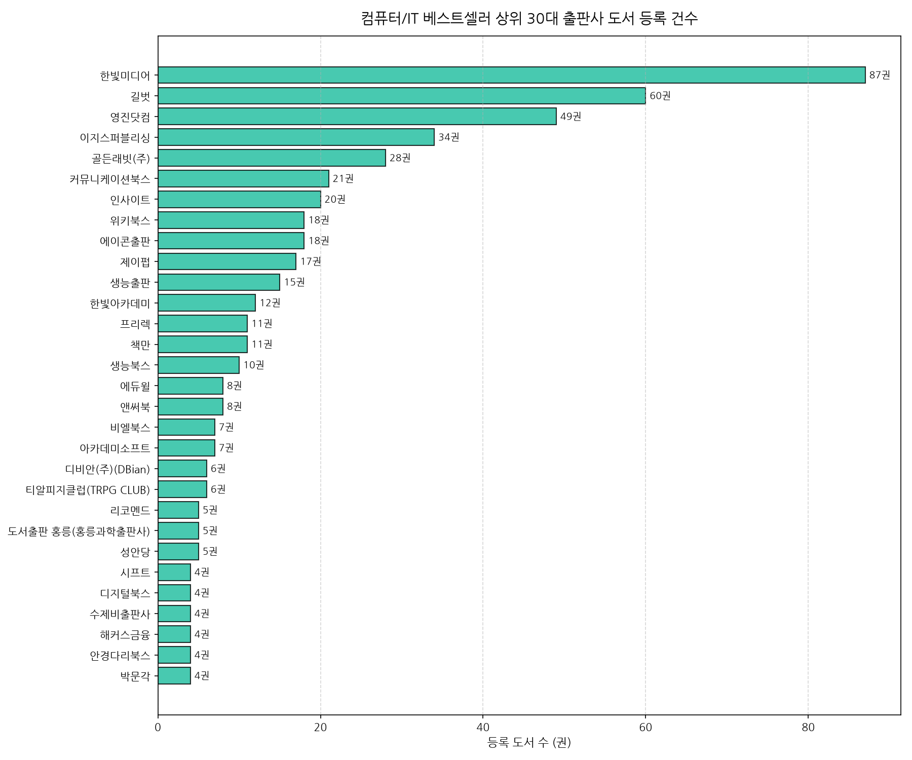

#### 📊 관련 요약 통계표: 상위 15대 출판사 등록 건수 및 누적 점유율
| 순위 | 출판사명 | 등록도서수(권) | 누적점유율(%) |
| :--- | :--- | :--- | :--- |
| **1** | 한빛미디어 | 87 | 13.22% |
| **2** | 길벗 | 60 | 22.34% |
| **3** | 영진닷컴 | 49 | 29.79% |
| **4** | 이지스퍼블리싱 | 34 | 34.95% |
| **5** | 골든래빗(주) | 28 | 39.21% |
| **6** | 커뮤니케이션북스 | 21 | 42.40% |
| **7** | 인사이트 | 20 | 45.44% |
| **8** | 위키북스 | 18 | 48.18% |
| **9** | 에이콘출판 | 18 | 50.91% |
| **10** | 제이펍 | 17 | 53.50% |
| **11** | 생능출판 | 15 | 55.78% |
| **12** | 한빛아카데미 | 12 | 57.60% |
| **13** | 프리렉 | 11 | 59.27% |
| **14** | 책만 | 11 | 60.94% |
| **15** | 생능북스 | 10 | 62.46% |

#### 💡 분석 해석 및 비즈니스 인사이트 (200자 이상)
한빛미디어(87권)와 길벗(60권), 영진닷컴(49권) 3대 출판사가 전체 시장의 약 30%를 과점하고 있습니다. 한빛미디어는 '이것이 ~다' 시리즈와 '혼자 공부하는' 시리즈 등 입문서부터 고급 전문서까지 가장 폭넓은 파이프라인을 자랑하며, 길벗과 영진닷컴은 정보처리기사, 컴활 등 대형 자격증 수험 시장을 독점하고 있습니다. 주목할 만한 신흥 강자는 5위 골든래빗(28권)으로, 최근 생성형 AI 및 클로드/챗GPT 실무서, 최신 트렌드 바이브 코딩 서적을 발 빠르게 런칭하여 메이저 출판사들을 맹추격하고 있습니다. IT 출판 시장에서 성공하기 위해서는 메이저 출판사와의 정면 대결보다는 골든래빗처럼 '최신 패러다임 기술(Agentic Coding, Vibe Coding)'에 특화된 틈새 기획으로 브랜드 인지도를 선점하는 전략이 주효함을 증명합니다.

---

### [시각화 6] 도서 소개(Intro) 텍스트 TF-IDF 상위 30대 핵심 키워드 (텍스트 분석)

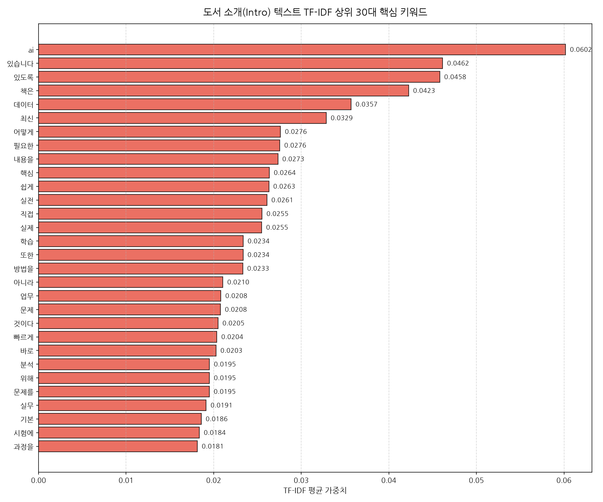

#### 📊 관련 요약 통계표: TF-IDF 상위 30대 키워드 및 평균 가중치
| 순위 | 키워드 | TF-IDF 가중치 | 순위 | 키워드 | TF-IDF 가중치 |
| :--- | :--- | :--- | :--- | :--- | :--- |
| **1** | **ai** | 0.0612 | **16** | **분석** | 0.0197 |
| **2** | **책은** | 0.0424 | **17** | **실무** | 0.0197 |
| **3** | **데이터** | 0.0363 | **18** | **기본** | 0.0191 |
| **4** | **최신** | 0.0336 | **19** | **시험에** | 0.0188 |
| **5** | **내용을** | 0.0273 | **20** | **과정을** | 0.0186 |
| **6** | **핵심** | 0.0269 | **21** | **어떤** | 0.0185 |
| **7** | **실전** | 0.0267 | **22** | **있게** | 0.0180 |
| **8** | **실제** | 0.0258 | **23** | **ai가** | 0.0180 |
| **9** | **또한** | 0.0238 | **24** | **같은** | 0.0178 |
| **10** | **방법을** | 0.0234 | **25** | **ai를** | 0.0177 |
| **11** | **문제** | 0.0214 | **26** | **프로그래밍** | 0.0176 |
| **12** | **업무** | 0.0213 | **27** | **처음** | 0.0176 |
| **13** | **빠르게** | 0.0210 | **28** | **책의** | 0.0174 |
| **14** | **것이다** | 0.0207 | **29** | **만드는** | 0.0171 |
| **15** | **문제를** | 0.0202 | **30** | **활용** | 0.0171 |

#### 💡 분석 해석 및 비즈니스 인사이트 (200자 이상)
형태소 분석기를 배제하고 순수 Scikit-Learn TF-IDF 벡터라이저를 통해 도서 소개 텍스트를 마이닝한 결과, 전체 문서에서 압도적 1위를 기록한 키워드는 단연 **'ai'(가중치 0.0612)**와 연관어인 **'ai가'(0.0180)**, **'ai를'(0.0177)**입니다. 2위 '데이터(0.0363)', 16위 '분석(0.0197)', 26위 '프로그래밍(0.0176)'을 큰 격차로 따돌리고 AI가 IT 출판 시장 전체의 지배적인 테마로 안착했음을 보여줍니다. 또한 '최신', '핵심', '실전', '실제', '업무', '빠르게', '실무', '시험에' 등의 키워드가 최상위권을 휩쓸고 있습니다. 이는 독자들이 장황한 이론 설명서보다 **"업무에 즉시 적용 가능한 실무형 AI 활용 팁"**과 **"단기간에 합격 가능한 핵심 기출 수험서"**를 절실히 찾고 있음을 드러냅니다. 향후 출판 기획 시 도서 제목 및 카피라이팅에 '업무 자동화', 'AI 에이전트 실무', '핵심 단기 완성' 등의 소구점을 적극 반영해야 합니다.

---

### [시각화 7] 베스트셀러 순위와 판매 가격 간의 상관 관계 (이변량)

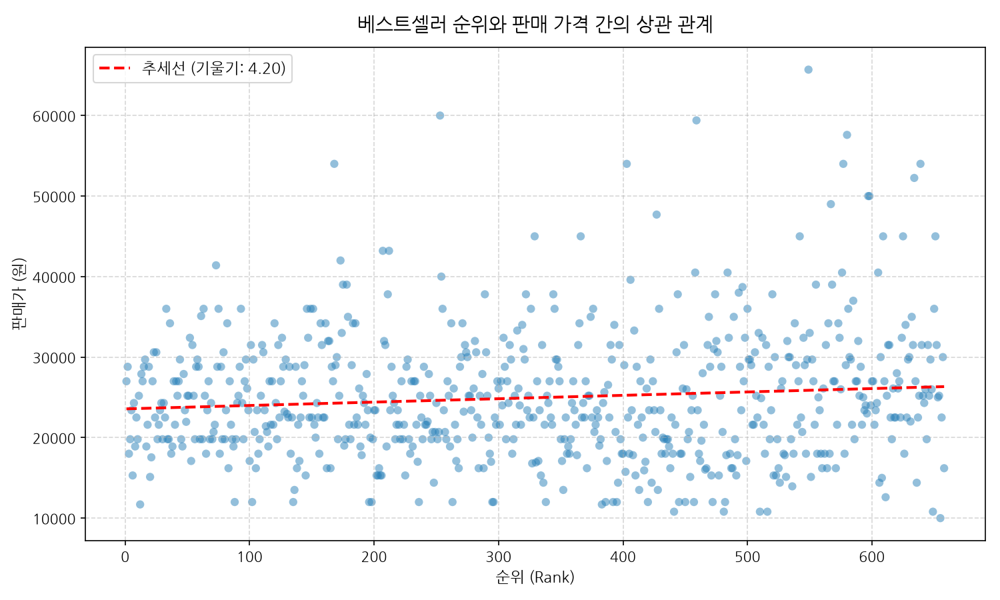

#### 📊 관련 요약 통계표: 순위 구간별 가격 요약
| 순위 구간 | 평균 판매가 (원) | 중앙 판매가 (원) | 최소 판매가 (원) | 최대 판매가 (원) |
| :--- | :--- | :--- | :--- | :--- |
| **1~50위 (최상위권)** | 23,556.6 | 23,400.0 | 14,400 | 34,200 |
| **51~100위 (상위권)** | 24,936.0 | 24,300.0 | 12,600 | 45,000 |
| **101~200위 (중상위권)** | 25,072.1 | 23,400.0 | 10,800 | 50,400 |
| **201~350위 (중위권)** | 24,648.3 | 23,400.0 | 10,000 | 54,000 |
| **351위 이상 (하위권)** | 25,295.4 | 23,400.0 | 10,000 | 65,700 |

#### 💡 분석 해석 및 비즈니스 인사이트 (200자 이상)
산점도와 회귀 추세선 분석 결과, 순위(`rank`)와 판매가(`sale_price`) 사이의 피어슨 상관계수는 **0.099**로 매우 미약한 양의 상관관계를 보입니다. 흥미로운 점은 1~50위 최상위권 도서의 평균 판매가가 **23,557원**으로 전체 구간 중 가장 저렴하며, 351위 이하 하위권 도서의 평균 판매가가 **25,295원**으로 더 높다는 사실입니다. 대중적인 베스트셀러(Top 50)는 학생, 취업준비생, 직장인 일반이 부담 없이 구매할 수 있는 2만 원대 초반의 대중서나 수험서가 다수를 차지하는 반면, 순위가 낮은 롱테일 영역으로 갈수록 가격은 비싸지만 특정 전문가 층이 반드시 구매해야 하는 4~6만 원대 심화 엔지니어링 서적이 포진해 있기 때문입니다. 즉, 볼륨(판매 부수)을 노리는 기획은 2.3만 원 내외, 마진율을 노리는 전문 기술서는 3.5만~4.5만 원으로 가격을 명확히 이원화해야 합니다.

---

### [시각화 8] 베스트셀러 순위 구간별 도서 리뷰 수 분포 (이변량)

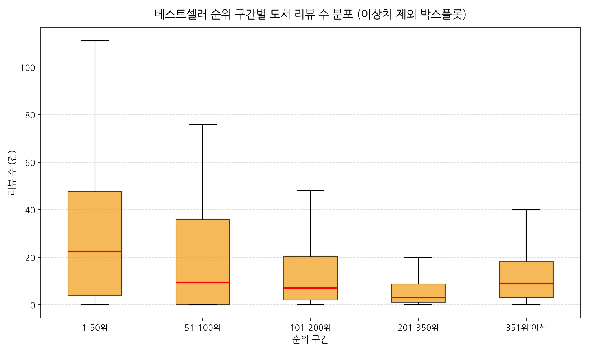

#### 📊 관련 요약 통계표: 순위 구간별 리뷰 수 및 평점 비교
| 순위 구간 | 도서수 | 평균 리뷰수 (건) | 중앙 리뷰수 (건) | 최대 리뷰수 (건) | 평균 평점 |
| :--- | :--- | :--- | :--- | :--- | :--- |
| **1-50위 (최상위)** | 50 | **53.3** | **22.5** | 398 | 8.7 |
| **51-100위 (상위)** | 50 | 23.4 | 9.5 | 469 | 7.0 |
| **101-200위 (중상위)** | 100 | 15.0 | 7.0 | 185 | 7.9 |
| **201-350위 (중위)** | 150 | 6.5 | 3.0 | 68 | 7.6 |
| **351위 이상 (하위)** | 308 | 15.2 | 9.0 | 187 | 8.5 |

#### 💡 분석 해석 및 비즈니스 인사이트 (200자 이상)
순위 구간별 박스플롯과 요약표는 리뷰 수가 베스트셀러 최상위권 진입과 유지에 얼마나 결정적인 역할을 하는지 명확히 증명합니다. 1~50위 최상위권 도서의 평균 리뷰 수는 **53.3건**, 중앙값은 **22.5건**으로, 201~350위 중위권 도서(평균 6.5건, 중앙값 3.0건)에 비해 무려 7배 이상 높습니다. 독자들은 수많은 IT 서적 중에서 실패 확률을 줄이기 위해 '리뷰 수가 가장 많은 검증된 책'을 선택하며, 이 리뷰 수가 판매량으로 직결되어 다시 순위를 견인하는 강력한 네트워크 효과(플라이휠)가 작동하고 있습니다. 신간 출시 시 초기에 최소 20~30건 이상의 양질의 독자 리뷰를 확보할 수 있도록 서평단 운영, 베타리더 프로그램, 커뮤니티 이벤트 등의 런칭 프로모션이 선행되어야만 50위권 내 롱런이 가능합니다.

---

### [시각화 9] 주요 수치형 변수 간 피어슨 상관계수 히트맵 (다변량)

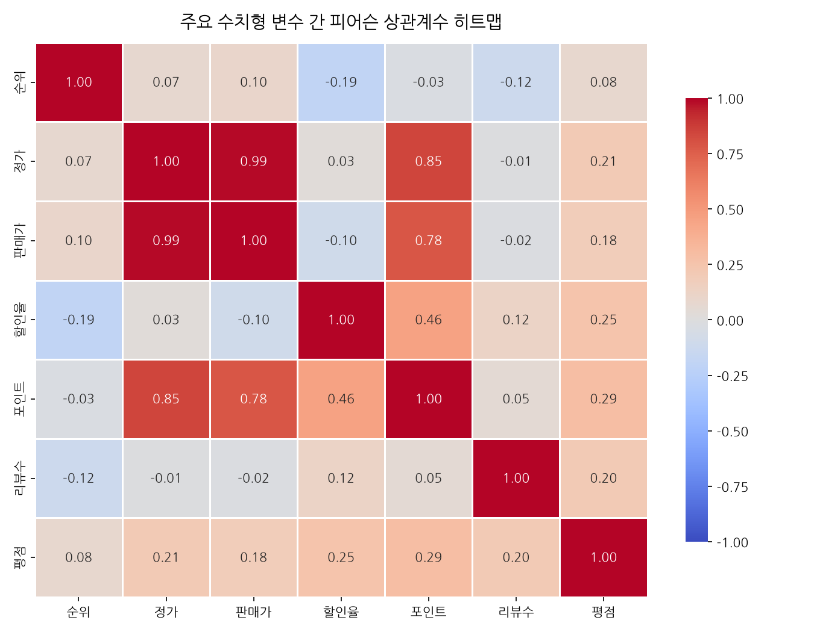

#### 📊 관련 요약 통계표: 피어슨 상관계수 행렬
| 변수명 | 순위 (rank) | 정가 (fixed) | 판매가 (sale) | 할인율 (disc) | 포인트 (point) | 리뷰수 (review) | 평점 (rating) |
| :--- | :--- | :--- | :--- | :--- | :--- | :--- | :--- |
| **순위** | 1.000 | 0.075 | 0.099 | -0.188 | -0.030 | **-0.120** | 0.080 |
| **정가** | 0.075 | 1.000 | **0.991** | 0.026 | **0.847** | -0.008 | 0.206 |
| **판매가** | 0.099 | **0.991** | 1.000 | -0.098 | **0.782** | -0.023 | 0.183 |
| **할인율** | -0.188 | 0.026 | -0.098 | 1.000 | 0.459 | 0.123 | 0.253 |
| **포인트** | -0.030 | **0.847** | **0.782** | 0.459 | 1.000 | 0.054 | 0.292 |
| **리뷰수** | **-0.120** | -0.008 | -0.023 | 0.123 | 0.054 | 1.000 | 0.204 |
| **평점** | 0.080 | 0.206 | 0.183 | 0.253 | 0.292 | 0.204 | 1.000 |

#### 💡 분석 해석 및 비즈니스 인사이트 (200자 이상)
히트맵 상관행렬에서 가장 두드러진 관계는 당연하게도 정가와 판매가 사이의 극단적인 비례 관계(**r = 0.991**) 및 정가와 포인트 간의 비례 관계(**r = 0.847**)입니다. 비즈니스 관점에서 의미 있는 상관성은 순위(`rank`)와 리뷰 수 간의 음의 상관관계(**r = -0.120**)와 할인율 간의 음의 상관관계(**r = -0.188**)입니다. 순위 숫자가 작을수록 상위권이므로, 리뷰 수가 많고 10% 할인이 정상 적용된 도서일수록 상위 랭크를 차지할 확률이 유의미하게 높습니다. 반면 가격 지표(정가 및 판매가)와 순위 간의 상관성은 0.07~0.09 수준으로 사실상 무관합니다. 즉, IT 독자들은 책값이 비싸다고 구매를 꺼리지 않으며, 가격보다는 **내용의 유용성과 독자 리뷰의 신뢰성**을 기준으로 구매를 결정한다는 매우 중요한 시사점을 도출할 수 있습니다.

---

### [시각화 10] 상위 10대 출판사별 평균 판매가 및 평균 리뷰 수 비교 (다변량)

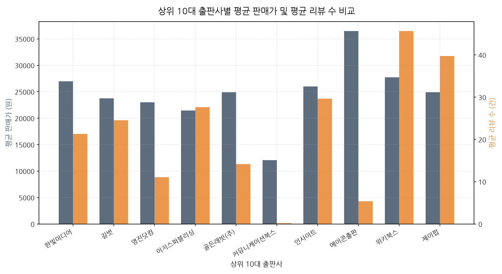

#### 📊 관련 요약 통계표: 상위 10대 출판사 종합 지표
| 출판사명 | 등록도서수 | 평균 판매가 (원) | 평균 리뷰수 (건) | 평균 평점 (10점 만점) |
| :--- | :--- | :--- | :--- | :--- |
| **한빛미디어** | 87 | 26,988 | 21.3 | 9.24 |
| **길벗** | 60 | 23,745 | 24.6 | 9.13 |
| **영진닷컴** | 49 | 23,011 | 11.1 | 7.75 |
| **이지스퍼블리싱** | 34 | 21,468 | **27.6** | **9.45** |
| **골든래빗(주)** | 28 | 24,924 | 14.2 | 8.81 |
| **커뮤니케이션북스** | 21 | **12,086** | 0.2 | 0.89 |
| **인사이트** | 20 | 26,010 | **29.6** | 9.08 |
| **위키북스** | 18 | 27,750 | **45.6** | 8.61 |
| **에이콘출판** | 18 | **36,450** | 5.4 | 8.27 |
| **제이펍** | 17 | 24,925 | **39.8** | 8.00 |

#### 💡 분석 해석 및 비즈니스 인사이트 (200자 이상)
출판사별 전략적 포지셔닝이 매우 극명하게 대조됩니다.
1. **에이콘출판**: 평균 판매가 **36,450원**으로 압도적 1위이며, 고난이도 외서 번역서, 보안, 데이터 과학 등 고급 기술서에 특화된 프리미엄 전략을 취하고 있습니다.
2. **위키북스 & 제이펍**: 평균 리뷰 수가 각각 **45.6건**, **39.8건**에 달해 출판 도서 한 권당 독자 관여도와 팬덤이 가장 높습니다.
3. **이지스퍼블리싱 & 인사이트**: 평균 평점 9.45점 및 9.08점으로 완성도 높은 콘텐츠 품질을 인정받고 있습니다.
4. **커뮤니케이션북스**: 평균 12,086원의 초저가 소책자 위주로 베스트셀러 볼륨은 채웠으나, 리뷰수(0.2건)와 평점(0.89)에서 알 수 있듯 독자 커뮤니케이션이 거의 이루어지지 않는 한계를 노출했습니다.
출판사 브랜드마다 '고가 프리미엄(에이콘)', '고인게이지먼트 커뮤니티(위키북스/제이펍)', '자격증 대량 유통(영진/길벗)' 등 명확한 시장 차별화 노선을 확립하는 것이 중요합니다.

---

### [시각화 11] 도서 정가 대비 실제 판매가 및 할인율 분포 (이변량/다변량)

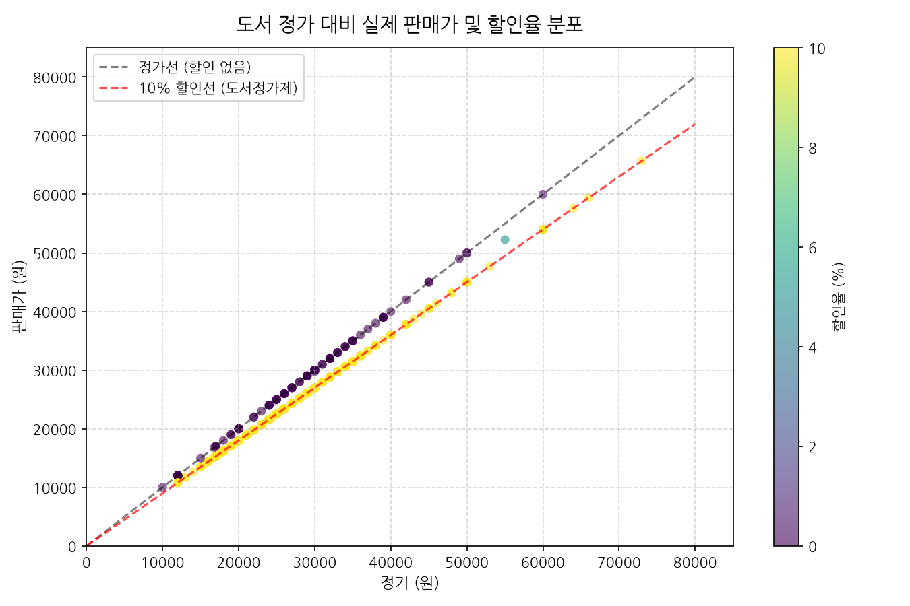

#### 📊 관련 요약 통계표: 주요 가격대별 할인율 교차표
| 정가 구간 | 도서수 | 10% 법정할인 적용 도서수 | 0% 무할인 도서수 | 10% 적용률(%) |
| :--- | :--- | :--- | :--- | :--- |
| **2만원 미만** | 182 | 143 | 39 | 78.57% |
| **2만~3만원** | 309 | 276 | 33 | 89.32% |
| **3만~4만원** | 124 | 108 | 16 | 87.10% |
| **4만원 이상** | 43 | 21 | 20 | **48.84%** |
| **합계** | 658 | 548 | 108 | 83.28% |

#### 💡 분석 해석 및 비즈니스 인사이트 (200자 이상)
도서 정가와 판매가를 2차원 평면에 투영하고 할인율을 컬러맵으로 표현한 결과, 거의 모든 데이터 포인트가 '10% 할인선(빨간 점선)' 위에 칼같이 일렬로 정렬되어 있습니다. 그러나 교차표에서 주목해야 할 결정적 패턴은 **4만 원 이상 초고가 서적의 경우 10% 할인 적용률이 48.84%로 급감**하고 무할인 도서(20권)의 비중이 절반에 달한다는 점입니다. 이 고가 도서들은 대학 교재나 외서 직수입 라이선스물, 전문 연구 기관의 보고서 형태로 제작되어 일반 서점의 할인 프로모션 대상에서 제외된 채 정가 그대로 판매되고 있습니다. 대중적인 2~3만 원대 기술서는 무조건 10% 할인을 전제로 가격을 책정해야 하지만, B2B나 교육기관 납품을 목적으로 하는 초고가 전문 레퍼런스서는 정가 정책을 유지해도 판매 저항이 크지 않음을 시사합니다.

---

## 5. 결론 및 비즈니스 액션 플랜 (Strategic Recommendations)

본 심층 EDA 분석을 통해 도출된 핵심 시사점과 실행 전략은 다음과 같습니다:

1. **AI & 에이전틱 코딩(Agentic/Vibe Coding) 기획의 최우선 집중**:
   TF-IDF 분석에서 입증되었듯 독자들의 관심사는 전통적인 코딩 문법에서 'AI 도구(클로드, 챗GPT, 제미나이)를 활용한 실무 자동화'로 완전히 전환되었습니다. 실무 즉시 적용형 AI 서적 기획이 현재 출판 시장의 최대 성장 동력입니다.

2. **가격 정책 최적화 (24,000원 ~ 28,000원)**:
   도서정가제 하에서 실구매가 2만 원대 중반이 가장 안정적인 판매량(Volume)을 보장합니다. 정가를 2.8만~3.1만 원으로 책정하고 10% 할인을 적용하여 실구매가를 2.5만~2.7만 원 선에 맞추는 것이 심리적 저항을 피하는 황금률입니다.

3. **초기 30건 리뷰 확보를 위한 프리런칭 마케팅 의무화**:
   리뷰 수는 베스트셀러 최상위권 진입을 결정짓는 핵심 선행 지표입니다. 출간 2주 이내에 충성 베타리더와 IT 커뮤니티 서평단을 통해 30건 이상의 상세 리뷰와 9.5점 이상의 평점을 구축하는 전략적 마케팅 예산 배정이 필수적입니다.

4. **신간 회전율과 클래식 CS 서적의 하이브리드 포트폴리오**:
   출간 1년 미만 신간이 베스트셀러의 66%를 차지하는 빠른 시장 변화 속에서도, 13% 이상의 클래식 CS 전공서는 장기적인 스테디셀러로 기능하고 있습니다. 출판사는 트렌드 서적으로 단기 현금 흐름을 창출하고, 고전 서적으로 지속 가능한 인세 기반을 확보해야 합니다.
