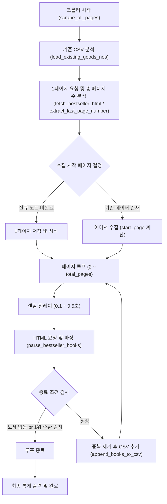

# YES24 일별 베스트셀러 크롤러 명세서

본 문서는 [`yes24/src/yes24_bestseller_scraper.py`](../src/yes24_bestseller_scraper.py) 스크립트의 구조, 동작 원리, 데이터 수집 파이프라인 및 출력 스펙을 기술합니다.

---

## 1. 개요 및 목적
* **대상 사이트**: YES24 도서 (IT 모바일 분야)
* **수집 주기**: 일별 베스트셀러 (Day Bestseller)
* **목적**: IT 모바일 분야 전체 베스트셀러 도서 목록을 수집하여 도서명, 가격, 저자, 출판사, 평점, 판매지수 등을 구조화된 CSV 데이터로 축적
* **저장 위치**: [`yes24/data/yes24_day_bestseller.csv`](../data/yes24_day_bestseller.csv)

---

## 2. 주요 기능 및 아키텍처



### 핵심 설계 특징
1. **비동기 엔드포인트 직접 호출**:
   * YES24의 비동기 콘텐츠 주소(`https://www.yes24.com/product/category/BestSellerContents`)로 직접 GET 요청하여 불필요한 브라우저 렌더링 비용을 최소화하고 속도를 극대화합니다.
2. **이어서 수집 (Append & Resume)**:
   * 기존 CSV 파일 내 `goods_no`를 Set 구조로 미리 메모리에 로드하여, 크롤링 중단 후 재실행 시 이미 수집된 페이지를 건너뛰고 이어서 수집합니다.
3. **페이징 및 순환 감지**:
   * 페이지 번호가 범위를 초과하여 다시 1위로 되돌아가는 현상(순환 버그)을 방지하는 안전 탈출 코드가 포함되어 있습니다.
4. **서버 친화적 지연 시간**:
   * 매 페이지 요청마다 `0.1 ~ 0.5초` 랜덤 대기를 부여하여 차단 및 서버 부하를 방지합니다.

---

## 3. 함수별 상세 명세

| 함수명 | 설명 | 주요 입출력 |
|---|---|---|
| [`clean_text(text)`](../src/yes24_bestseller_scraper.py#L53) | HTML 태그 제거, 엔티티 이중 디코딩 및 공백 정규화 | `str` -> `str` |
| [`fetch_bestseller_html(page_number, page_size)`](../src/yes24_bestseller_scraper.py#L71) | 비동기 엔드포인트에 브라우저 모사 헤더를 포함한 GET 요청 수행 | `int, int` -> `str` |
| [`extract_last_page_number(html_text)`](../src/yes24_bestseller_scraper.py#L137) | 페이징 네비게이션 영역 분석을 통한 마지막 페이지 번호 자동 감지 | `str` -> `int` |
| [`parse_bestseller_books(html_text)`](../src/yes24_bestseller_scraper.py#L168) | HTML 및 내부 `ORD_GOODS_OPT` JSON 객체 결합 파싱 (18개 필드 추출) | `str` -> `list[dict]` |
| [`load_existing_goods_nos(csv_filepath)`](../src/yes24_bestseller_scraper.py#L311) | 중복 방지를 위한 기존 CSV 상품 번호 Set 로드 | `str` -> `set[str]` |
| [`append_books_to_csv(books, output_filepath)`](../src/yes24_bestseller_scraper.py#L338) | 신규 수집 도서 목록을 CSV 끝에 추가 저장 (BOM UTF-8 인코딩) | `list[dict], str` -> `int` |
| [`scrape_all_pages(output_csv)`](../src/yes24_bestseller_scraper.py#L366) | 전체 크롤링 파이프라인 총괄 실행 함수 | `str` -> `None` |

---

## 4. 데이터 스키마 (CSV 필드 정의)

출력 파일인 [`yes24_day_bestseller.csv`](../data/yes24_day_bestseller.csv)는 총 18개의 컬럼으로 구성됩니다:

| 컬럼명 | 데이터 타입 | 설명 | 예시 |
|---|---|---|---|
| `rank` | Integer | 베스트셀러 순위 | `1` |
| `goods_no` | String | YES24 고유 상품 번호 | `194483933` |
| `title` | String | 도서명 | `클로드 코드 제대로 시작하기` |
| `subtitle` | String | 부제 및 소개 문구 | `최신 클로드 코드 완벽 반영! ...` |
| `author` | String | 저자 / 역자 | `주홍철, 황진성 저` |
| `publisher` | String | 출판사 | `길벗` |
| `pub_date` | String | 출간일 | `2026년 08월` |
| `category` | String | 도서 카테고리 | `IT 모바일` |
| `fixed_price` | Integer | 정가 (원) | `32000` |
| `sale_price` | Integer | 판매가 (원) | `28800` |
| `discount_rate` | Integer | 할인율 (%) | `10` |
| `point` | Integer | 적립 포인트 (원) | `1600` |
| `rating` | Float | 회원 평점 (10점 만점) | `9.8` |
| `review_count` | Integer | 작성된 회원 리뷰 수 | `20` |
| `sales_index` | Integer | YES24 판매지수 | `41985` |
| `tags` | String | 연관 해시태그 (쉼표 구분) | `#클로드코드, #분철` |
| `url` | String | 상품 상세 페이지 URL | `https://www.yes24.com/product/goods/194483933` |
| `image_url` | String | 도서 표지 대표 이미지 URL | `https://image.yes24.com/goods/194483933/L` |

---

## 5. 실행 방법

가상환경 및 실행은 `uv` 명령어를 기준으로 수행합니다:

```bash
# 워크스페이스 루트에서 실행
uv run python yes24/src/yes24_bestseller_scraper.py
```
