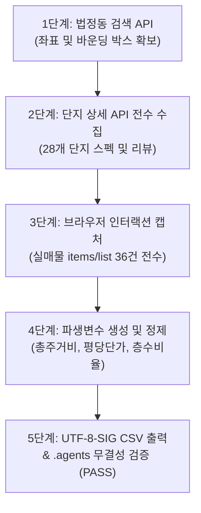

# 📋 세종 정부청사 생활권 오피스텔 데이터 수집 기획서

본 문서는 세종특별자치시 정부청사 생활권(어진동·나성동·도담동)의 오피스텔 단지 및 실매물 데이터를 무결하게 수집하기 위한 전략 기획서입니다.

---

## 1. 수집 배경 및 목적
- **배경**: 세종특별자치시 정부청사 인근은 공무원 및 공공기관 종사자의 1인 가구 실거주 비율이 압도적으로 높은 특수 시장입니다.
- **목적**:
  1. 어진동 단독뿐만 아니라 인접 배후 주거지인 나성동, 도담동까지 포함하여 비교 분석
  2. 표면 월세에 가려진 관리비를 포함한 '월 총 실주거비용' 메커니즘 규명
  3. 전용 평당 단가, 층수/조망 프리미엄, 노후도에 따른 감가상각을 데이터 사이언스 기반으로 실증 분석

---

## 2. 수집 대상 및 지리적 범위

| 행정동 | 중심 위경도 | 주요 특성 | 대표 단지 |
| :--- | :---: | :--- | :--- |
| **어진동** | 36.5005, 127.2634 | 정부청사 도보 5~10분, 세종호수공원 조망 | 세종푸르지오시티 1/2차, 더리치호수의아침, 한뜰마을 단지군 |
| **나성동** | 36.4851, 127.2651 | 세종 유일 중심상업지구, 어반아트리움, 신축 주상복합 | 세종포레뷰 1/2차, 나릿재마을 단지군 |
| **도담동** | 36.5131, 127.2619 | 청사 북측 배후 주거지, 홈플러스 상권, BRT 접근성 | 라온프라이빗시티, 까사누보, 도램마을 단지군 |

---

## 3. 데이터 수집 단계 및 무결성 기준

### 무결성 검증 기준:
- 결측치율: 핵심 필드(보증금, 월세, 전용면적, 행정동) 결측 0%
- 인코딩: 엑셀 호환 UTF-8-SIG 보장
- 좌표계: WGS84 위도/경도 유효 범위 보장
