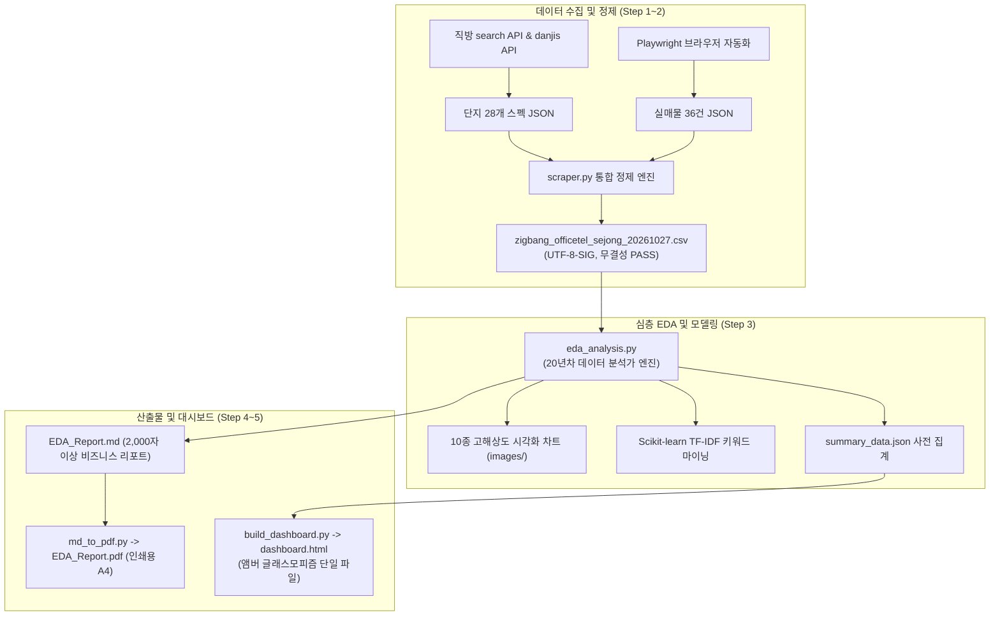

# 🛠️ 세종 오피스텔 엔드투엔드 파이프라인 구현 설계서

본 문서는 데이터 수집부터 EDA, 대시보드 구축 및 아티팩트 보존까지의 엔드투엔드 파이프라인 구현 아키텍처를 정의합니다.

---

## 1. 아키텍처 다이어그램

---

## 2. 파일별 책임과 역할

1. `src/scraper.py`:
   - 단지와 매물 데이터 통합 및 정제
   - 파생변수(`total_monthly_cost_manwon`, `unit_rent_per_pyeong`, `manage_cost_per_pyeong`, `building_age`, `floor_ratio`) 생성
   - `data/zigbang_officetel_sejong_20261027.csv` 저장
2. `src/eda_analysis.py`:
   - 기술통계 산출 및 10개 차트 생성 (`images/01~10_*.png`)
   - TF-IDF 텍스트 마이닝
   - `data/summary_data.json` 사전 집계
3. `src/build_dashboard.py`:
   - 단일 HTML 번들러
   - Chart.js 6대 차트 및 실시간 검색/정렬/필터링/계산기 탑재
4. `src/md_to_pdf.py`:
   - Markdown 보고서를 인쇄용 A4 PDF로 자동 컴파일
